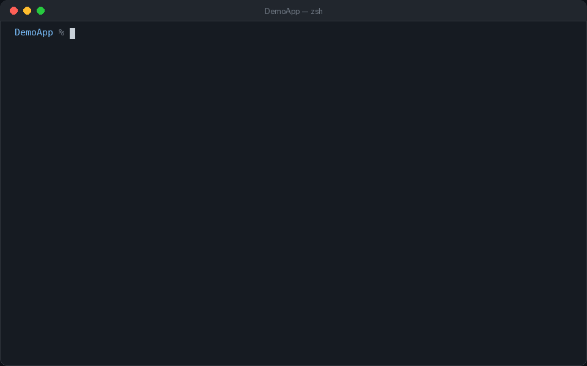
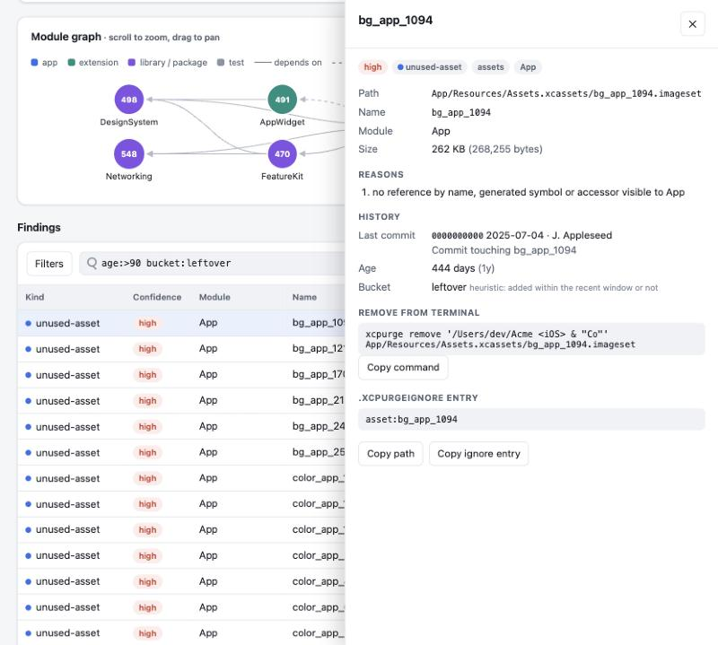
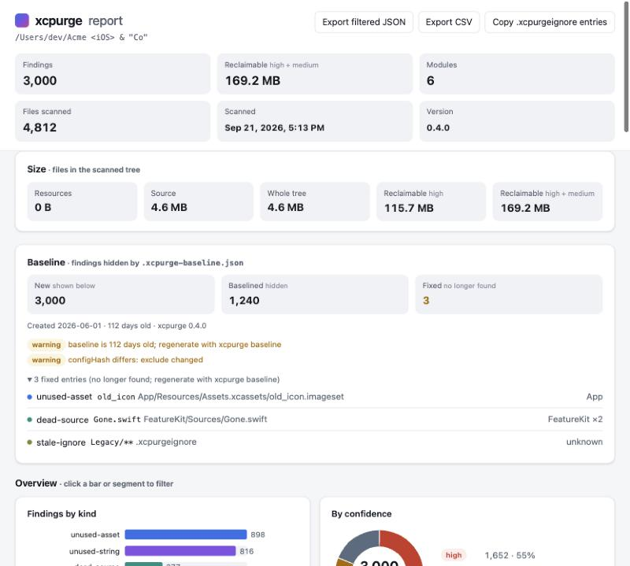
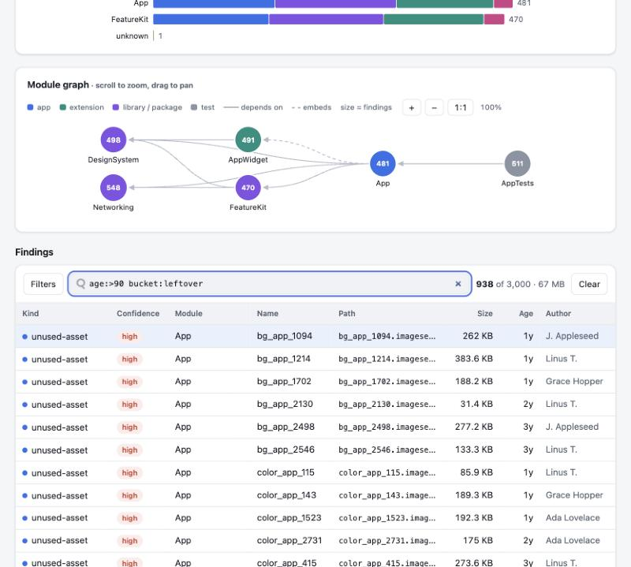

# xcpurge

[](https://github.com/iasaeed/xcpurge/releases)
[](https://github.com/iasaeed/xcpurge/actions/workflows/ci.yml)
[](LICENSE)


*Scans a 12,000-file app in about 7 seconds with no build. Every finding shows its evidence and can be undone.*

## What xcpurge does

xcpurge finds things in an Xcode project that nothing uses: images, colors, fonts, localized strings and files.
It reads your project files and does not build your app. A scan never changes anything.

Every finding has a confidence level (high, medium or low) that says how sure xcpurge is. When you clean up, files
go to a trash folder inside your project. One command puts them back.




Contents: [Install](#install) · [60-second start](#60-second-start) · [Pick your task](#pick-your-task) ·
[Reading a finding](#reading-a-finding) · [Ignoring things](#ignoring-things) ·
[Command reference](#command-reference) · [Troubleshooting / FAQ](#troubleshooting--faq) ·
[How it works](#how-it-works) · [Contributing](#contributing) · [License](#license)

## Install

You need macOS 14 or newer and Xcode 26 or 27 (Swift 6).

**Homebrew** (a package manager for macOS):

```sh
brew install iasaeed/tap/xcpurge
```

**Release binary.** Each GitHub release has `xcpurge-macos.tar.gz` (one binary for Apple silicon and Intel) and a
`.sha256` checksum that proves the download is intact. CI jobs use this: it is fast and pinned to one version.

```sh
mkdir -p ~/.local/bin
base=https://github.com/iasaeed/xcpurge/releases/download/v0.5.0
curl -fsSLO "$base/xcpurge-macos.tar.gz" && curl -fsSLO "$base/xcpurge-macos.tar.gz.sha256"
shasum -a 256 -c xcpurge-macos.tar.gz.sha256 && tar -xzf xcpurge-macos.tar.gz -C ~/.local/bin
```

**From source:**

```sh
git clone https://github.com/iasaeed/xcpurge.git && cd xcpurge
# builds a release binary and copies it to /usr/local/bin (or ~/.local/bin)
make install
```

Check it works: `xcpurge --version` prints `0.5.0`. `xcpurge doctor` shows the Xcode and Swift it found.

If the shell says `command not found: xcpurge`, the folder is not on your PATH (the list of folders the shell
searches for commands). Add `export PATH="$HOME/.local/bin:$PATH"` to `~/.zshrc` and open a new Terminal window.

## 60-second start

Open Terminal and go to your project folder: the folder with your `.xcodeproj`, `.xcworkspace` or `Package.swift`.

```sh
cd ~/path/to/MyApp
```

Tip: type `cd ` (with the space), drag the folder from Finder onto the Terminal window, then press Return.

`sh` blocks below are commands to type or paste. `text` blocks show what xcpurge prints. In the full captures in
`docs/examples` and the guide, lines starting with `$` are what you type; don't type the `$`.

**1. Scan.** This only reads files. The `.` means "this folder".

```sh
xcpurge scan .
```

Output from `ClassicApp`, a small test project in `Tests/Fixtures`:

```text
Assets (1, 70 B)
  unused-asset
    ClassicApp
      [high]   ClassicApp/unused_loose.png  unused_loose.png  (70 B)

Files (4, 455 B)
  …
  orphan-file
    unknown
      [medium] ClassicApp/Orphan.swift  (143 B)
          inside a project group folder but not referenced by any project
          Xcode may exclude it on purpose
…
Total: 8 findings (6 high, 2 medium, 0 low), 665 B reclaimable
```

Each line is one finding: `[confidence]`, the path, the name and the size. Findings are grouped by category, then
kind, then module. A **module** is one thing that gets built: an app target, an extension, a framework or a Swift
package target.

**2. Open the same results in your browser.**

```sh
xcpurge scan . --format html --open
```

The HTML report is one file with search, filters and charts. xcpurge saves it in `.xcpurge/` and opens it. Without
`--open`, it prints where the file is (this run was on a bigger test project):

```text
Wrote html report to /path/to/YourApp/.xcpurge/report-20261030-195638.html
Scanned 35 files in 5 modules in 1.0s — 27 findings (12 high, 5 medium, 10 low)
Open it with: open "/path/to/YourApp/.xcpurge/report-20261030-195638.html"
```

Add `.xcpurge/` to your `.gitignore`.

**3. Remove one thing, then undo it.**

Two words first. `project.pbxproj` is the file inside your `.xcodeproj` where Xcode lists every file of the
project. A **session** is one trash folder per run, inside `.xcpurge-trash/`, so each run can be undone on its own.

Copy a path from the scan output in place of `PATH-FROM-SCAN`. xcpurge shows what it will do and asks before moving
anything. Type `y` and press Return.

```sh
xcpurge remove . PATH-FROM-SCAN
```

```text
  ClassicApp/unused_loose.png
  edit ClassicApp.xcodeproj/project.pbxproj
Move 1 path(s) to .xcpurge-trash? [y/N] y
  moved ClassicApp/unused_loose.png
  rewrote ClassicApp.xcodeproj/project.pbxproj
Removed 2 item(s). Undo with: xcpurge restore --session 20261030-200232
```

The two items are the image and the old copy of `project.pbxproj`. Now undo it:

```sh
xcpurge restore .
```

```text
  restored ClassicApp/unused_loose.png
  restored ClassicApp.xcodeproj/project.pbxproj
Restored 2 item(s) from session 20261030-200232.
```

The image is back, and `project.pbxproj` is byte for byte as before. Add `.xcpurge-trash/` to `.gitignore` too.

## Pick your task

### Find unused images, colors and fonts

**When:** your asset catalogs (`.xcassets` folders) have grown and you suspect dead images.

```sh
xcpurge assets .
```

You will see `unused-asset` (images, colors, app icons, data sets, loose `.png` files), `unused-font` and
`duplicate` (the same image bytes stored twice). From the `ModularWorkspace` test project:

```text
  unused-asset
    App
      [medium] App/App/Assets.xcassets/LegacyIcon.appiconset  LegacyIcon  (6.6 KB)
          app icon set not named by ASSETCATALOG_COMPILER_APPICON_NAME, ALTERNATE_APPICON_NAMES, INCLUDE_ALL_APPICON_ASSETS or Info.plist icons
      [low]    App/App/Assets.xcassets/icon_1.imageset  icon_1  (226 B)
          no reference by name, generated symbol or accessor visible to App
          may be built dynamically at App/App/ContentView.swift:15 ("icon_…")
      [high]   App/App/Assets.xcassets/unused_app_image.imageset  unused_app_image  (236 B)
```

The word in brackets is the **confidence**. `high` means nothing that can see the image names it: no code,
storyboard, plist or build setting. `medium` and `low` mean "probably unused, but look first".

The indented lines under a finding are the reasons. See [Reading a finding](#reading-a-finding).

**Next:** remove the high ones (see [Delete safely and undo](#delete-safely-and-undo)). For medium and low, run
`xcpurge explain . NAME`, with the name from the report in place of `NAME`, and decide yourself.

### Find unused localized strings

**When:** your `Localizable.xcstrings` (a string catalog) or `.strings` files hold keys nobody reads any more.

```sh
xcpurge strings .
```

```text
  stale-string
    App
      [high]   App/App/Localizable.xcstrings:49  old_banner
  unused-string
    App
      [low]    App/App/Localizable.xcstrings:4  error_404
          no reference found; Xcode will mark it stale on the next build
          may be built dynamically at App/App/ContentView.swift:20
      [high]   App/App/Localizable.xcstrings:26  manual_unused
```

A **stale** key is one Xcode itself already marked as no longer in the code. `error_404` is low because the app
builds keys at runtime with `"error_\(code)"`, so it may still be used.

**Next:** `xcpurge strings . --prune` removes the high-confidence keys from every language. It asks first and backs
up the old files in `.xcpurge-trash/`. `xcpurge restore .` undoes it.

If you wrap `NSLocalizedString` in your own function, for example `L("key")`, pass `--localization-macro L`. Then
xcpurge sees those calls too.

### Find orphan, ghost and dead files

**When:** the project folder has files no target builds, or the project lists files that are gone.

```sh
xcpurge files .
```

It reports four kinds of file finding:

| Kind | Meaning | Example |
|---|---|---|
| `orphan-file` | On disk, but in no target. | `Orphan.swift` sits in a group folder; the project never mentions it. |
| `ghost-reference` | In the project, but missing on disk. | `Ghost.swift` was deleted in Finder; `project.pbxproj` still lists it. |
| `dead-source` | A whole source file whose types nothing else uses. | `DeadObjC.m` declares a class no file uses. |
| `unused-resource`, `unused-interface-file` | A bundled data file, xib or storyboard nothing loads. | `Unused.plist`, `Unused.xib` |

**Next:** `xcpurge files . --delete` moves orphans, unused resources and unused xibs/storyboards to the trash.
Dead-source files and ghost references are only reported. Remove one of those yourself with `xcpurge remove . FILE-PATH`.

### Delete safely and undo

**When:** you have checked the findings and want them gone. In these commands, `FILE-PATH` stands for a path from
the report, for example `App/Old.swift`. Run one line at a time; do not paste the whole block.

```sh
# everything high-confidence at once: unused assets, files and strings
xcpurge purge .
# unused assets (high confidence only)
xcpurge assets . --delete
# orphans, unused resources and interface files (high only)
xcpurge files . --delete
# unused string keys (high only)
xcpurge strings . --prune
# exactly these paths, whatever their kind or confidence
xcpurge remove . FILE-PATH
# list trash sessions
xcpurge restore . --list
# undo the newest session
xcpurge restore .
# put back only this path, keep the rest of the session in the trash
xcpurge restore . --path FILE-PATH
```

Each action prints what it moved, a `Size before → after` table and the exact undo command, such as
`Undo with: xcpurge restore --session 20261030-194738`.

`purge` does what the three cleanup commands above do, in one run and one trash session. Narrow it down when you
want less:

```sh
# show what would go, change nothing
xcpurge purge . --dry-run
# only one category, or only one kind of finding
xcpurge purge . --only strings
xcpurge purge . --only orphan-file
# exactly these findings (ids from the report), whatever their confidence
xcpurge purge . --ids unused-asset-9532ffca6e,orphan-file-5f22e12c23
```

It asks once, listing everything grouped by category. `xcpurge restore .` undoes the whole purge.

How it stays safe:

- Each run is a **trash session**: one folder in `.xcpurge-trash/SESSION/` with the moved files, the old project
  file and a list of what happened. Nothing is deleted for real.
- `--delete`, `--prune` and `purge` touch **high** findings only, unless you pass `--min-confidence` yourself
  (or pick findings by id with `purge --ids`).
- They ask before acting, and `--yes` skips the question. Without a terminal (CI, a script, an AI agent) and without
  `--yes`, nothing happens: xcpurge stops with an error status (exit code 2; all codes are listed under
  [Exit codes](#exit-codes)).
- Duplicates are never moved. You choose which copy to keep.

The HTML report has a **Remove from terminal** box for every file finding, with a ready `xcpurge remove` command:



To remove many at once, tick findings in the report. The first column has a checkbox per row; the header checkbox
selects every row currently visible, so filter first (kind, category, module, confidence, search) and then
"select all visible" to pick a whole type. A bar at the bottom shows how many are selected, their total size, and a
**Copy purge command** button with a ready `xcpurge purge <root> --ids <id>,<id>,...` line. Duplicates and
informational findings have a disabled checkbox because `purge` never removes them.

**Next:** build the app, run it, then commit the removal in its own commit.

### Make sure a delete does not break the build

**When:** you want proof that the app still compiles without the removed files.

```sh
xcpurge files . --delete --yes --verify \
  "xcodebuild -scheme SCHEME -destination 'generic/platform=iOS' -derivedDataPath .build/verify -quiet build"
```

Replace `SCHEME` with your scheme (`xcodebuild -list` shows them). Add `-workspace` or `-project` to the build
command if the folder holds several. `--verify` works on `assets --delete`, `files --delete`, `purge` and `remove`.
On `purge` it covers the files moved to the trash, not the pruned string keys.

- **Preflight:** before anything is removed, xcpurge runs your build once. If that build already fails, nothing is
  removed and xcpurge stops with an error status (exit code 4; all codes are listed under [Exit codes](#exit-codes)).
- **After the removal:** it builds again.
- **On failure:** it reads the build errors and puts back the files the build needs. It marks them as blocked, so
  later runs skip them.

Below is real output from a test run. The real build was replaced by the shell command `true`, which always
succeeds.

```text
--verify: preflight build (true)
--verify: build 1/8: after removing 1 unit(s)
--verify: 1 removed and build-verified, 0 blocked (restored), 0 restored unverified; 1 build(s) used of 8 (plus the preflight)
build-verified, not runtime-verified (dynamic lookups, other schemes/configurations and tests are not covered)
```

A **unit** is one removed file or asset set. **Blocked (restored)** units were put back because the build needed
them. **Restored unverified** units were put back because the build limit (`--verify-max-builds`) ran out before
xcpurge could prove they were safe to remove.

That last line is always printed, and it matters. **Build-verified** means the app compiles. It does not mean the
app works.

A build cannot see `UIImage(named:)` with a name built at runtime, other schemes, or tests. Keep the trash session
until you have run the app.

### Stop new junk in CI with a baseline

**CI** (continuous integration) is the server that checks every pull request. A **baseline** is a saved list of
today's findings, so CI only complains about new ones. Use it when an old project has hundreds of findings that
nobody will fix this week.

```sh
# writes .xcpurge-baseline.json; commit it
xcpurge baseline .
# in CI: fail only on new findings
xcpurge scan . --baseline .xcpurge-baseline.json --fail-on any
```

The scan prints one line about the baseline:

```text
Baseline .xcpurge-baseline.json (0 days): 8 baselined, 0 new, 0 fixed
```

- `--fail-on any` makes the scan stop with exit code 1 when it finds anything new. `--fail-on unused-assets` or
  `--fail-on dead-source` narrow it to a category or a kind.
- **Fixed** entries are in the baseline but no longer found. They only warn; `--strict-baseline` makes them fail.
  Rerun `xcpurge baseline .` to refresh the file.
- The baseline warns when it is older than 90 days (`--baseline-max-age`).
- **Stale ignores** are ignore rules that hide nothing any more, for example `Vendor/**` after you deleted
  `Vendor/`. They show up as `stale-ignore` findings. `--fail-on-stale-ignore` fails on them; `--no-stale-ignore`
  hides them.

[docs/ci/xcpurge.yml](docs/ci/xcpurge.yml) is a complete GitHub Actions workflow. It downloads a pinned release
binary and uses the baseline. It scans with `--format github`, so findings appear as comments on the changed lines.

Copy it to `.github/workflows/` in your repository.

**Show it in your README.** Once CI runs xcpurge, you can add a badge. Copy this line into your own `README.md`:

```markdown
[](https://github.com/iasaeed/xcpurge)
```

The HTML report shows the baseline at the top:



### Watch app size in pull requests

**When:** you want each pull request to show how much it grew the project.

```sh
# on main
xcpurge size . --save size-base.json
# on the pull request
xcpurge size . --compare size-base.json --format markdown \
  --comment-threshold 100KB --fail-if-grows 500KB --output size.md
```

What you see (shortened, from `ModularWorkspace` after a 3 KB image was added):

```text
### xcpurge size: +2.9 KB (+9.1%)

Source-tree bytes (files in the repository), not shipped bytes.

|  | Base | PR | Change |
|---|---:|---:|---:|
| Whole tree | 32.1 KB | 35.1 KB | +2.9 KB (+9.1%) |
| Asset catalogs | 17.3 KB | 20.3 KB | +2.9 KB (+16.9%) |
```

- `--fail-if-grows 500KB` (or `2%`) stops with exit code 1 when the total grew by more than that.
- `--comment-threshold 100KB` prints nothing when the change is smaller, so small PRs get no comment.

Be clear about what is measured. Without `--app`, the numbers are **files in the repository**, not the size of
your app.

With `--app` and the path to your built `.app` (or `.ipa`) on both sides, the headline is the install size of the
app. That is still not the App Store download size, which Apple shrinks per device.

[docs/ci/xcpurge-size.yml](docs/ci/xcpurge-size.yml) is a complete workflow. It saves the base on `main`. On each
pull request it posts one comment and edits it on every push (a **sticky comment**).

### See findings inside Xcode

**When:** you want findings as yellow warnings in Xcode's Issue navigator.

```sh
xcpurge init --xcode-phase
```

This prints a **Run Script phase** (a shell script Xcode runs during a build). It writes nothing. The real script
starts like this:

```sh
# xcpurge Run Script phase (xcpurge 0.5.0). Add after "Compile Sources".
# Either set ENABLE_USER_SCRIPT_SANDBOXING = NO for this target, or add $(SRCROOT) to Input File Lists.
# Output Files: $(DERIVED_FILE_DIR)/xcpurge.stamp  (lets Xcode skip the phase when nothing changed)
…
xcpurge scan "${SRCROOT}" --format xcode --min-confidence medium --quiet --max-warnings 50 || echo "warning: xcpurge exited $? (run xcpurge --version to check the install)"
```

Where to paste it: select your app target, open **Build Phases**, click **+**, choose **New Run Script Phase**,
paste the script, and drag the phase below **Compile Sources**.

**Sandbox note:** Xcode's **User Script Sandboxing** stops scripts from reading files they did not declare. Either
set `ENABLE_USER_SCRIPT_SANDBOXING = NO` for that target, or add `$(SRCROOT)` to **Input File Lists** and
`$(DERIVED_FILE_DIR)/xcpurge.stamp` to **Output Files**.

The script never fails your build. It does nothing when the `CI` environment variable is set, so CI builds skip
it. If xcpurge is not installed, it prints one warning and goes on.

By default it runs only for the Release configuration (`--configuration any` changes that). It shows at most 50
warnings (`--max-warnings`).

### Know who added it and when

**When:** you want to ask the right person before removing something.

```sh
xcpurge files . --git
```

```text
git history: 3 of 4 finding(s) annotated, 1 not committed
  dead-source
    ClassicApp
      [high]   ClassicApp/DeadObjC.m  (91 B)  · 0d, Dev
  ghost-reference
    ClassicApp
      [high]   ClassicApp/Ghost.swift  · n/a (untracked)
```

Each finding gets its last commit: author, date and age in days. The HTML report adds **Age** and **Author**
columns, and you can search for `age:>90`:



- Age is context only. It never changes the confidence.
- **Privacy:** only author names are shown. Emails appear only with `--git-emails`, and only in JSON.
- A **shallow clone** (a checkout without history, the GitHub Actions default) shows `n/a`. In GitHub Actions, add
  `fetch-depth: 0` under `with:` of the `actions/checkout` step (see [docs/ci/xcpurge.yml](docs/ci/xcpurge.yml)).
- `--git-dead-since` guesses the commit that removed the last use of a name. It is a guess, and it is slower.

### Use it with AI coding agents

**When:** an agent such as Claude Code, Codex or Cursor does the cleanup for you.

`--format agent` prints plain text made for agents. Each row has a stable id, the confidence and short reason
codes. It also has a ready `remove:` command and the `.xcpurgeignore` line that would hide it:

```text
- id=unused-asset-ab15ed7993 high Legacy/LegacyAssets.xcassets/legacy_unused.imageset name=legacy_unused reasons=no-ref
  remove: xcpurge remove --yes /path/to/MixedApp Legacy/LegacyAssets.xcassets/legacy_unused.imageset
  ignore: asset:legacy_unused
```

`/path/to/MixedApp` is where this test project was; you will see your own folder. The `remove:` line has `--yes`
because an agent has no terminal to answer the question.

`xcpurge explain . ID-OR-NAME` shows the evidence for one finding. It lists the modules it checked, every place the
name appears (`reference sites`) and runtime-built names that could match (`dynamic patterns`). It also shows how
the confidence was decided.

[skills/xcpurge/SKILL.md](skills/xcpurge/SKILL.md) is a ready agent skill. Copy the `skills/xcpurge` folder into
your agent's skills folder. Or paste these 8 lines into your `AGENTS.md` or `CLAUDE.md`:

```markdown
## Unused resources (xcpurge)
- Scan with `xcpurge scan . --format agent --output /tmp/xcpurge.txt`; read the legend first.
- `high`: run the printed `remove:` command, then build and run tests. Rescan afterwards.
- `medium`/`low` are leads, not verdicts: run `xcpurge explain . ID` and check every reference site
  and dynamic pattern before removing anything.
- Undo with `xcpurge restore .`. Keep removals in their own commit on a clean branch.
- Never add `.xcpurgeignore` entries or `// xcpurge:ignore` markers to make a scan green; an ignore
  needs a `# reason` comment on the line above it explaining where the thing is used.
```

### Multi-module projects

**When:** your app is split into Swift packages, frameworks or several projects in one workspace.

```sh
xcpurge modules .
```

```text
Modules (5)
  App  [app]  App/App.xcodeproj  files: 23
    depends on: AppWidget, Core, DesignSystem
    embeds: AppWidget
    visible to: AppTests
    roots: App/App
  …
  DesignSystem  [packageLibrary]  Packages/DesignSystem  files: 4
    depends on: Core
    visible to: App, AppTests
    roots: Packages/DesignSystem/Sources/DesignSystem
```

How visibility works: a use of a name only counts if the file that uses it can see the module that owns the
resource, which means it is in that module or in a module that depends on or embeds it. So if only `Core` names an
image in `DesignSystem`, and `Core` does not depend on `DesignSystem`, the image is still unused.

- `--targets App,DesignSystem` reports findings in those modules only.
- Scan the folder that holds the whole workspace (or pass `--workspace`), so every project is read.
- CocoaPods: the `Pods/` folder is skipped. Pass `--include-pods` to scan it too.

## Reading a finding

Every finding has one of three confidence levels:

| Level | In plain words | Example from `ModularWorkspace` |
|---|---|---|
| **high** | Nothing that can see it names it. Safe to remove after a quick look. | `unused_app_image`: no code, storyboard, plist or setting in `App` names it. |
| **medium** | Probably unused, but there is a hint it might be used. Look first. | `LegacyIcon.appiconset`: app icons are often chosen by build settings, not code. |
| **low** | Maybe used at runtime. Check by hand. | `icon_1`: the app calls `Image("icon_\(i)")`, which could build that name. |

A **dynamic lookup** is a name built while the app runs, such as `Image("icon_\(i)")` or
`NSLocalizedString("error_\(code)", …)`. xcpurge cannot know every value, so it reports the line as an info
finding (`dynamic-lookup`) and lowers every matching finding to low. Low findings are never deleted by default.

Things that also lower confidence: a plain string with the same name somewhere else, reading `Bundle.main` instead
of the package bundle, use only from SwiftUI previews, or public API of a library nobody in the repo uses.

## Ignoring things

**`.xcpurgeignore`** sits in the project folder. It works like `.gitignore`: the last matching rule wins, and `!`
brings a path back. `xcpurge init` writes a commented starter file.

```text
# every path under Vendor
Vendor/**
# the top-level Scripts folder only
/Scripts/
# but still report this file
!Vendor/Keep.swift
# assets loaded by name from the server
asset:server_driven_*
# localization keys sent in push payloads
string:push.*
# every finding in one module
module:LegacyKit
# every dead-source finding
kind:dead-source
```

A `#` only starts a comment at the beginning of a line, so put each comment on its own line above the rule.
`kind:` hides a whole kind of finding; use the kind names from the report, such as `kind:dead-source`.
These rules are samples. Keep only the ones that match your project, or xcpurge reports the rest as `stale-ignore`.
`asset:` rules do not hide `duplicate` findings; use a path rule for those.

**Inline:** put `// xcpurge:ignore - reason` on a line of code, or alone on the line above a declaration. It hides
findings on that line. Always write the reason.

**`xcpurge.json`** sets defaults for a project. Command-line flags win over it. Comments and trailing commas are
allowed, and `xcpurge init` writes a starter file next to `.xcpurgeignore`.

| Key | What it does | Default |
|---|---|---|
| `project` | Scan only this `.xcodeproj` (`--project`). | none |
| `workspace` | Scan the projects and packages of this `.xcworkspace` (`--workspace`). | none |
| `package` | Scan only this Swift package (`--package`). | none |
| `targets` | Report findings only in these modules (`--targets`). | `[]` (all) |
| `format` | Output format (`--format`). | `text` |
| `failOn` | Exit with code 1 when findings match these values (`--fail-on`). | `[]` |
| `minConfidence` | Hide findings below this level: `low`, `medium` or `high` (`--min-confidence`). | `low` |
| `exclude` | Globs (path patterns like `Vendor/**`) never reported; still read for uses (`--exclude`). | `[]` |
| `derivedData` | DerivedData folder (Xcode's build folder) to read generated asset names from (`--derived-data`). | newest match |
| `includePods` | Also scan `Pods/` (`--include-pods`). | `false` |
| `ignoreTestReferences` | Uses in test targets do not count (`--ignore-test-references`). | `false` |
| `retainPublic` | Never report public code of libraries as dead (`--retain-public`). | `false` |
| `noSwift` | Read `Package.swift` as text instead of running `swift` (`--no-swift`). | `false` |
| `verbose` | Print more detail (`--verbose`). | `false` |
| `localizationMacros` | Your own localization function names, like `L` (`--localization-macro`). | `[]` |
| `baseline` | Baseline file whose findings are hidden (`--baseline`). | none |
| `baselineMaxAgeDays` | Warn when the baseline is older than this many days; 0 never warns (`--baseline-max-age`). | `90` |
| `staleIgnores` | Report ignore rules that hide nothing (`false` = `--no-stale-ignore`). | `true` |
| `testFixtureDirectories` | Folder names of snapshot-test reference images; files inside are never reported as unused or orphaned (still counted by `xcpurge size`). | `["__Snapshots__", "ReferenceImages", "ReferenceImages_64", "FailureDiffs"]` |

`exclude` is not the same as `.xcpurgeignore`. Excluded files are still read, so a name used only inside them
still counts as used. That makes it safe to exclude generated or vendored code.

## Command reference

`xcpurge COMMAND --help` prints the same flags. `scan` is the default command, so `xcpurge` alone means
`xcpurge scan .`. `FOLDER` is the project folder and defaults to `.`; uppercase words are placeholders.

Every command takes these two flags:

| Flag | What it does | Default |
|---|---|---|
| `--version` | Print the xcpurge version and stop. | off |
| `-h`, `--help` | Print the command's flags and stop. | off |

### scan

`xcpurge scan [FOLDER]` reports unused assets, strings and files. It never changes anything. The same flags work on
`assets`, `strings`, `files`, `purge`, `baseline`, `explain`, `size` and `modules`.

| Flag | What it does | Default |
|---|---|---|
| `--project FILE` | Scan only this `.xcodeproj`. | all found |
| `--workspace FILE` | Scan the projects and packages of this `.xcworkspace`. | all found |
| `--package PATH` | Scan only this Swift package (folder or `Package.swift`). | all found |
| `--targets NAMES` | Only report findings in these modules (comma-separated). | all modules |
| `--format FORMAT` | Output format: `text`, `json`, `xcode`, `github`, `html`, `agent`, `markdown` (only `size` accepts `markdown`; see [Output formats](#output-formats)). | `text` |
| `--output FILE` | Write the report to this file instead of the terminal. | terminal; html: `.xcpurge/report-TIME.html` |
| `--open` | Open the HTML report when it is written. | off |
| `--browser APP` | App for `--open`, for example `"Google Chrome"`. | default browser |
| `--fail-on WHAT` | Exit 1 when findings match: `any`, `assets`, `strings`, `files`, `duplicates`, `unused-CATEGORY` or a kind. | off |
| `--min-confidence LEVEL` | Hide findings below `low`, `medium` or `high`. | `low` |
| `--exclude GLOB` | Never report paths matching this glob; they are still read for uses. Repeatable. | none |
| `--config FILE` | Config file to read. | `PATH/xcpurge.json` |
| `--derived-data FOLDER` | DerivedData folder to read Xcode's generated asset names from. | newest match |
| `--localization-macro NAME` | Treat this function as a localization call. Repeatable. | none |
| `--include-pods` | Scan `Pods/` too. | off |
| `--ignore-test-references` | Do not count uses from test targets. | off |
| `--retain-public` | Never report public code of libraries as dead source. | off |
| `--no-swift` | Read `Package.swift` as text instead of running `swift` (see the note below). | off |
| `-v`, `--verbose` | Print more detail: reasons, info messages, which file went to which module. | off |
| `-q`, `--quiet` | No progress, summary or hints (warnings and errors still print). | off |
| `--max-warnings N` | Show at most this many `--format xcode` warnings, then a summary line. | no cap |
| `--agent-limit N` | Rows per kind in `--format agent`; `0` shows all. | `30` |
| `--baseline FILE` | Hide findings listed in this baseline and report fixed ones. | none |
| `--strict-baseline` | Exit 1 when the baseline lists findings that are fixed. | off |
| `--baseline-max-age DAYS` | Warn when the baseline is older than this; `0` never warns. | `90` |
| `--no-stale-ignore` | Do not report ignore rules that hide nothing. | reported |
| `--fail-on-stale-ignore` | Exit 1 on an ignore rule that hides nothing. | off |
| `--git` | Add each finding's last commit: author, date and age. | off |
| `--git-emails` | With `--git`: also show author emails (JSON only). | names only |
| `--git-dead-since` | With `--git`: guess the commit that removed the last use (slower). | off |
| `--git-recent-days N` | With `--git`: paths added within this many days count as "recently added". | `30` |

**About `--no-swift`.** By default xcpurge runs `swift package dump-package` on every `Package.swift` it finds, which compiles and executes that manifest. On a project you do not trust, or in CI where speed matters, pass `--no-swift` to use the built-in manifest text parser instead (about 10x faster on package-heavy repos).

### assets

`xcpurge assets [FOLDER]` reports unused assets, fonts and duplicates. All `scan` flags, plus:

| Flag | What it does | Default |
|---|---|---|
| `--delete` | Move unused assets to `.xcpurge-trash` (high confidence unless `--min-confidence` is given). | off |
| `-y`, `--yes` | Do not ask for confirmation. | asks |
| `--verify COMMAND` | Build before and after the removal; put back what the build needs. | off |
| `--verify-timeout SECONDS` | Time limit per build; a timeout restores everything and exits 4. | `1800` |
| `--verify-max-builds N` | Most builds `--verify` may run after the removal (the preflight is extra). | `8` |

### strings

`xcpurge strings [FOLDER]` reports unused and stale localized strings. All `scan` flags, plus:

| Flag | What it does | Default |
|---|---|---|
| `--prune` | Remove reported keys from string catalogs and `.strings` files (backups go to the trash). | off |
| `-y`, `--yes` | Do not ask for confirmation. | asks |

### files

`xcpurge files [FOLDER]` reports orphan, ghost, dead-source and unused resource files. All `scan` flags, plus:

| Flag | What it does | Default |
|---|---|---|
| `--delete` | Move reported files to the trash and drop their project references (high unless `--min-confidence`). | off |
| `-y`, `--yes` | Do not ask for confirmation. | asks |
| `--verify COMMAND` | Build before and after the removal; put back what the build needs. | off |
| `--verify-timeout SECONDS` | Time limit per build; a timeout restores everything and exits 4. | `1800` |
| `--verify-max-builds N` | Most builds `--verify` may run after the removal. | `8` |

### remove

`xcpurge remove . PATHS` moves exactly these files or asset sets to the trash and drops their project references.
The first argument is the project root folder and is required (`.` for the current folder). It ignores kind and
confidence. Plain folders are refused: pass the files inside.

| Flag | What it does | Default |
|---|---|---|
| `-y`, `--yes` | Do not ask for confirmation. | asks |
| `-q`, `--quiet` | No progress or hints. | off |
| `--verify COMMAND` | Build before and after the removal; put back what the build needs. | off |
| `--verify-timeout SECONDS` | Time limit per build; a timeout restores everything and exits 4. | `1800` |
| `--verify-max-builds N` | Most builds `--verify` may run after the removal. | `8` |

### purge

`xcpurge purge [FOLDER]` removes every actionable finding in one go: unused assets and files go to the trash (with
their project references), unused string keys are pruned. It is `assets --delete`, `files --delete` and
`strings --prune` in one run and one trash session. Dead-source files, ghost references, duplicates and informational
findings are never touched.
All `scan` flags, plus:

| Flag | What it does | Default |
|---|---|---|
| `--only WHAT` | Act only on `assets`, `strings`, `files`, `unused-CATEGORY` or a kind (`orphan-file`). Repeatable, comma-separated. Kinds purge never acts on are refused. | everything |
| `--ids IDS` | Act only on these finding ids, whatever their confidence. Repeatable, comma-separated. Unknown ids are warned about. | all actionable |
| `--dry-run` | List what would be removed and print the report; change nothing. | off |
| `-y`, `--yes` | Do not ask for confirmation. | asks |
| `--verify COMMAND` | Build before and after the removal; put back what the build needs. | off |
| `--verify-timeout SECONDS` | Time limit per build; a timeout restores everything and exits 4. | `1800` |
| `--verify-max-builds N` | Most builds `--verify` may run after the removal. | `8` |

Without `--ids`, only high findings are acted on unless you pass `--min-confidence`. `--verify` build-checks the files
moved to the trash, not the pruned string keys. Undo with `xcpurge restore`.

### restore

`xcpurge restore [FOLDER]` undoes a delete, prune, purge or remove from `.xcpurge-trash`.

| Flag | What it does | Default |
|---|---|---|
| `--session ID` | Restore this trash session. | newest |
| `--path PATH` | Restore only this file or asset set and leave the rest in the trash. Repeatable. | whole session |
| `--list` | List trash sessions instead of restoring. | off |

### baseline

`xcpurge baseline [FOLDER]` writes today's findings to `.xcpurge-baseline.json`. It takes the `scan` flags, and
`--output` picks another file. `--format`, `--open` and `--browser` are rejected; there are no extra flags.

### explain

`xcpurge explain [FOLDER] SUBJECT` explains one finding. The subject is a finding id, a path or a name. It takes the
`scan` flags; `--format` is `text` or `json`.

It has no extra flags. It stops with exit code 2 when nothing matches and suggests close names.

### size

`xcpurge size [FOLDER]` measures the project by category and module, and estimates what a cleanup saves. All `scan`
flags (plus `--format markdown`), and:

| Flag | What it does | Default |
|---|---|---|
| `--app BUNDLE` | Also measure a built `.app` or `.ipa` (nothing is built). | off |
| `--save FILE` | Write a JSON snapshot to this file. | off |
| `--compare FILE` | Compare with a saved snapshot. | off |
| `--fail-if-grows LIMIT` | Exit 1 when the total grew by more than this: bytes (`100KB`, `2MB`) or a share (`2%`). | off |
| `--comment-threshold BYTES` | markdown/github: print nothing (and write no file) when the change is smaller. | off |
| `--top N` | markdown/github: how many changed paths to list. | `20` |
| `--min-path-delta BYTES` | markdown/github: hide paths that changed by less than this. | `500` |
| `--allow-missing-compare` | A missing `--compare` file is a note, not an error. | error |

### modules

`xcpurge modules [FOLDER]` shows the modules it found, what each depends on, and which module can see which. It
takes the `scan` flags; `--verbose` lists which file went to which module. No extra flags.

### init

`xcpurge init [FOLDER]` writes a starter `xcpurge.json` and `.xcpurgeignore`.

| Flag | What it does | Default |
|---|---|---|
| `--force` | Overwrite files that already exist. | off |
| `--xcode-phase` | Print a Run Script phase that shows findings as Xcode warnings; writes nothing. | off |
| `--configuration CONFIG` | With `--xcode-phase`: run only for this build configuration (`Release`), or `any`. | `Release` |
| `--max-warnings N` | With `--xcode-phase`: show at most this many warnings. | `50` |

### doctor

`xcpurge doctor [FOLDER]` prints the Xcode and Swift versions it found and the project formats in the folder. It has
no flags beyond `--version` and `--help`.

### Exit codes

The exit code is the number a command hands back to the shell or CI when it ends. `0` means success.

| Code | Meaning |
|---|---|
| `0` | Success. Findings alone do not fail a run. |
| `1` | A gate was hit: `--fail-on`, `--strict-baseline`, `--fail-on-stale-ignore` or `--fail-if-grows`. |
| `2` | Usage or config error, `explain` found nothing, or a delete without `--yes` and without a terminal. |
| `3` | Internal error (please report it). |
| `4` | `--verify` could not get a passing build: the preflight failed or a build timed out. |

### Output formats

| Format | Use it for |
|---|---|
| `text` | Reading in the terminal (the default). |
| `json` | Scripts. Follows [docs/schema/findings-v2.schema.json](docs/schema/findings-v2.schema.json). |
| `xcode` | Xcode build warnings (`file:line: warning: …`), for a Run Script phase. |
| `github` | GitHub Actions annotations on the pull request. |
| `html` | One self-contained report file with search, filters, charts and the module graph. |
| `agent` | Plain text for AI coding agents, with ids and ready commands. |
| `markdown` | Pull-request comments. Meant for `xcpurge size`; other commands reject it. |

## Troubleshooting / FAQ

**It says something is unused, but I use it.** Run `xcpurge explain . NAME` to see every place the name appears
and why none counted. Names built at runtime, sent by a server or used only from Kotlin or Dart are invisible: add an
`.xcpurgeignore` rule with a reason. If the use is in Swift, Objective-C, a storyboard or a plist, it is a bug:
please [file an issue](https://github.com/iasaeed/xcpurge/issues) with a small example project.

**I use SwiftGen or R.swift.** That works. Generated code such as `Asset.Colors.brand` or `R.image.settingsIcon` is
mapped back to the real names. Xcode's own generated symbols (`Image(.logo)`) are understood too.

**My image names come from a server.** xcpurge cannot see them. Add `asset:server_driven_*` to `.xcpurgeignore`, or
`// xcpurge:ignore - loaded by name from the server` where you load them.

**Names built from two variables** (`"\(base)-\(lang)"`) have no fixed prefix, so xcpurge cannot tell which files they load: add an `.xcpurgeignore` rule.

**What about CocoaPods?** `Pods/` is skipped. Pass `--include-pods` to scan it. The HTML report has a
**Show Pods** box.

**Synchronized folders (Xcode 16+)?** Supported. A synchronized folder is one Xcode mirrors into a target without
listing each file. A file excluded from every target is reported as an orphan, at medium, since that may be on
purpose.

**Xcode 27 JSON projects (`project.xcproj`)?** Read on a best-effort basis while the format settles. Removing files
from a `project.xcproj` is not supported yet; those files are skipped and listed. `xcpurge doctor` shows the format.

**It found nothing. Is it broken?** Maybe the project is clean. Run `xcpurge modules .` and check that your targets
have files. Then run `xcpurge doctor`; if you scanned a folder of several repositories, scan one project instead.

**The scan is slow.** Scans usually take seconds. Scan the project folder, not your home folder: `DerivedData`,
`node_modules`, `.build`, hidden folders and build output are already skipped. `--git-dead-since` and `--verify`
are the slow options.

**`command not found: xcpurge`.** Add `export PATH="$HOME/.local/bin:$PATH"` to `~/.zshrc` and open a new Terminal
window. With Homebrew, run `brew doctor`.

**How do I update?** `brew update && brew upgrade xcpurge`, then `xcpurge --version`. In CI, change
`XCPURGE_VERSION` in the workflow.

## How it works

xcpurge does not build your project. It reads files in five steps:

1. **Walk the disk** and skip folders that are never yours (`DerivedData`, `node_modules`, `Pods/`, build output).
2. **Map files to modules** by reading Xcode projects, synchronized folders, Swift packages and workspaces.
3. **Collect every name** from Swift, Objective-C, storyboards, xibs, plists, build settings and generated files.
4. **Check visibility:** a name counts only when the file using it can see the module that owns the resource.
5. **Set the confidence:** no visible use is high; a weak hint is medium; a runtime-built name is low.

The full explanation, every finding kind, the HTML report, `--verify` step by step, size snapshots and the agent
format are in the deep-dive guide: [docs/guide.md](docs/guide.md). Changes per version: [CHANGELOG.md](CHANGELOG.md).

## Contributing

- `make build`, `make test`, and `make template` after editing the HTML report template.
- `make package` (it runs `Scripts/package-release.sh`) builds the release archive and checksum into
  `.build/package/`.
- Fixtures live in `Tests/Fixtures/NAME`. Expected findings live in
  `Tests/Goldens/NAME/expected-CATEGORY.json`, outside the fixtures so scans never read them.
- Rewrite goldens with `XCPURGE_UPDATE_EXPECTED=1 swift test` and review the diff.
- `make corpus` runs read-only scans over real projects listed in `CORPUS`.
- `docs/examples/capture.sh` regenerates the example output quoted here and in the guide.

When something is reported wrongly, the most useful issue includes a minimal fixture that reproduces it.

## License

MIT, see `LICENSE`.
