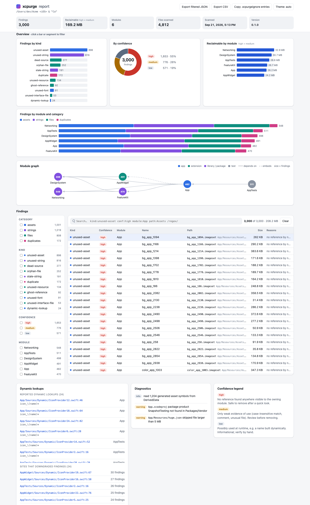

# xcpurge

Old Xcode projects collect dead weight: images nobody shows, strings nobody reads, files no target builds.
You can't safely delete them by hand, because a name might be used from another module, a storyboard, a plist
or a build setting. xcpurge reads all of those, works out which module can see which, and tells you what looks
unused, with a confidence level on every finding. Scanning never changes anything. When you do clean up, files
go to a restorable trash, so one command puts everything back.

```sh
brew install iasaeed/tap/xcpurge
cd YourApp
xcpurge scan --format html --open
```



## Contents

- [What does it find?](#what-does-it-find)
- [Install](#install)
- [Try it in 60 seconds](#try-it-in-60-seconds)
- [Field results](#field-results)
- [How does it decide?](#how-does-it-decide)
- [Project formats](#project-formats)
- [Multi-module projects and workspaces](#multi-module-projects-and-workspaces)
- [Ignoring things](#ignoring-things)
- [Output formats and CI](#output-formats-and-ci)
- [How do I remove things safely?](#how-do-i-remove-things-safely)
- [Measuring size](#measuring-size)
- [Using xcpurge from coding agents](#using-xcpurge-from-coding-agents)
- [Configuration reference](#configuration-reference)
- [Known limitations](#known-limitations) · [Roadmap](#roadmap) · [Comparison](#comparison) ·
  [Contributing](#contributing) · [FAQ](#faq)

## What does it find?

Findings fall into four categories: assets, strings, files and duplicates. Each finding has a kind:

| Kind | Example | Typical cause |
|---|---|---|
| `unused-asset` | `unused_app_image.imageset`, `LegacyIcon.appiconset`, a loose `unused_loose.png` | A screen was removed but its image, color, data or symbol set stayed. Covers app icons and loose images too. |
| `unused-font` | `Unused-Bold.otf` listed in `UIAppFonts` | A font was tried in a design and dropped. |
| `unused-string` | `manual_unused` in `Localizable.xcstrings`, a key in `Legacy.strings` | Copy changed, the key was never removed. Covers `.xcstrings`, `.strings`, `.stringsdict` and Settings.bundle. |
| `stale-string` | `old_banner`, which Xcode already marked stale | The source string is gone; Xcode keeps the translation until someone deletes it. |
| `orphan-file` | `Orphan.swift` on disk in no target | Removed from the project but not from disk; excluded from a synchronized folder; a group file in no build phase; a stray source. |
| `ghost-reference` | `Ghost.swift` in the project, missing on disk | Deleted in Finder or by a merge, still listed in `project.pbxproj`. |
| `dead-source` | `DeadHelper.swift`, `DeadObjC.m` | A whole file whose types nothing else uses. |
| `unused-interface-file` | `Unused.xib` | A screen rewritten in SwiftUI, its xib or storyboard left behind. |
| `unused-resource` | `unused.json`, `Unused.plist` | A bundled data file that no code loads. |
| `duplicate` | `dup_a.png` and `core_dup.png` | The same image (byte-identical) copied into two catalogs or loose files. |
| `dynamic-lookup` (info) | `Image("icon_\(i)")` | A name built at runtime. Reported so you know which findings it softens. |

### What do the confidence levels mean?

Every finding is **high**, **medium** or **low**. The level says how sure xcpurge is that nothing uses it.

- **high**: no reference anywhere the owning module is visible from. Safe to remove after a glance.
  Example: `unused_app_image` in the `ModularWorkspace` fixture. No code, storyboard, plist or setting that the
  App module can see names it.
- **medium**: likely unused, but there is a reason to look. Example: `LegacyIcon.appiconset`. No build setting
  names it, but app icons are often picked by settings or Info.plist rather than code. Other medium reasons: a
  bare string literal elsewhere, the main bundle read instead of the package bundle, a font declared in
  `UIAppFonts`.
- **low**: may be used at runtime. Example: `icon_1` and `icon_2`, because the app calls `Image("icon_\(i)")`.
  Other low reasons: only used from SwiftUI previews, extension-only files, public API of a library with no
  in-repo consumer.

The cleanup flags (`assets --delete`, `files --delete`, `strings --prune`) act on **high** findings only,
unless you pass `--min-confidence` yourself.

## Install

```sh
brew install iasaeed/tap/xcpurge
```

Or build from source:

```sh
git clone https://github.com/iasaeed/xcpurge.git && cd xcpurge
make install          # swift build -c release, then copies to /usr/local/bin (or ~/.local/bin)
# or just: swift build -c release   (binary at .build/release/xcpurge)
```

Requires macOS 14+ and Swift 6 (Xcode 26 or newer). A Mint package is planned.

### Release binary

Each GitHub release carries `xcpurge-macos.tar.gz` (a universal arm64 + x86_64 `xcpurge` at the archive root) and
its `.sha256`. The sample CI workflows download it pinned to a version instead of brewing:

```sh
base=https://github.com/iasaeed/xcpurge/releases/download/v0.4.0
curl -fsSLO "$base/xcpurge-macos.tar.gz" && curl -fsSLO "$base/xcpurge-macos.tar.gz.sha256"
shasum -a 256 -c xcpurge-macos.tar.gz.sha256 && tar -xzf xcpurge-macos.tar.gz -C ~/.local/bin
```

`make package` (`Scripts/package-release.sh`) builds that archive and checksum into `.build/package/`
(`XCPURGE_PACKAGE_DIR` picks another folder inside `.build/`). The archive is reproducible for the same binary
(fixed owner, mode and mtime from `SOURCE_DATE_EPOCH` or the HEAD commit date, `gzip -n`). A universal build
that fails stops the script; `ALLOW_HOST_ONLY=1` accepts a host-only archive for local testing.

The everyday commands:

```sh
xcpurge scan                          # everything, text report (the default subcommand)
xcpurge scan --format html --open     # everything, interactive HTML report opened in your browser
xcpurge scan --min-confidence medium  # hide low-confidence findings
xcpurge assets path/to/App            # assets + duplicates only
xcpurge size                          # bytes by category and module, and what a purge would reclaim
xcpurge modules --verbose             # how files were attributed to modules
xcpurge init                          # starter xcpurge.json and .xcpurgeignore
xcpurge doctor                        # Xcode/Swift versions and project formats found
```

## Try it in 60 seconds

The repository ships small test projects under `Tests/Fixtures`. Everything below is real output from
`swift build -c release` at commit 9c9387a, run from the repository root. Lines over 120 characters are
shortened with `…`; the full captures, and the script that makes them, are in [docs/examples](docs/examples).

### Scan a project

`ModularWorkspace` is an app, a widget, tests and two local Swift packages. The text report groups findings by
category, kind and module, with sizes and a total. Colors appear only on a terminal, and never when `NO_COLOR`
is set.

```
$ xcpurge scan Tests/Fixtures/ModularWorkspace
Assets (9, 8.1 KB)
  dynamic-lookup
    App
      [low]    App/App/ContentView.swift:15  icon_*
          asset name built at runtime; matching assets are reported with lower confidence
  unused-asset
    App
      [medium] App/App/Assets.xcassets/LegacyIcon.appiconset  LegacyIcon  (6.6 KB)
          app icon set not named by ASSETCATALOG_COMPILER_APPICON_NAME, ALTERNATE_APPICON_NAMES, INCLUDE_ALL_APPICON_AS…
      [low]    App/App/Assets.xcassets/icon_1.imageset  icon_1  (226 B)
          no reference by name, generated symbol or accessor visible to App
          may be built dynamically at App/App/ContentView.swift:15 ("icon_…")
      [low]    App/App/Assets.xcassets/icon_2.imageset  icon_2  (226 B)
          no reference by name, generated symbol or accessor visible to App
          may be built dynamically at App/App/ContentView.swift:15 ("icon_…")
      [high]   App/App/Assets.xcassets/unused_app_image.imageset  unused_app_image  (236 B)
    Core
      [high]   Packages/Core/Sources/Core/Resources/Core.xcassets/core_unused.imageset  core_unused  (231 B)
    DesignSystem
      [high]   Packages/DesignSystem/Sources/DesignSyste…esignSystem.xcassets/ds_isolated.imageset  ds_isolated  (231 B)
      [high]   Packages/DesignSystem/Sources/DesignSystem…s/DesignSystem.xcassets/ds_unused.colorset  ds_unused  (329 B)
  unused-font
    App
      [medium] App/App/Fonts/Unused-Bold.otf  Unused-Bold.otf  (55 B)
          declared in UIAppFonts of App but never used by file, PostScript, family or full name

  (Strings section omitted here; it is the same as `xcpurge strings` below.)

Files (6, 2.0 KB)
  dead-source
    App
      [high]   App/App/Dead/DeadHelper.swift  (71 B)
      [low]    App/App/ExtensionOnly.swift  (87 B)
          declares shouted; not referenced from another visible file
          extension-only file
      [low]    App/App/PreviewOnly.swift  (150 B)
          declares PreviewOnlyBadge; not referenced from another visible file
          only used from SwiftUI previews
    Core
      [low]    Packages/Core/Sources/Core/CoreImages.swift  (399 B)
          declares CoreImages; not referenced from another visible file
          public API of a library with no in-repo consumer
  unused-interface-file
    App
      [high]   App/App/Unused.xib  (1.3 KB)
  unused-resource
    App
      [high]   App/App/Data/unused.json  (22 B)

Duplicates (2, 70 B)
  duplicate
    App
      [high]   App/App/Assets.xcassets/dup_a.imageset/dup_a.png  dup_a  group 9cdae0dd58a8
    Core
      [high]   Packages/Core/Sources/Core/Resour…ts/core_dup.imageset/core_dup.png  core_dup  (70 B)  group 9cdae0dd58a8

Total: 27 findings (12 high, 5 medium, 10 low), 10.1 KB reclaimable
```

Full output: [scan-modularworkspace.txt](docs/examples/scan-modularworkspace.txt).

### See the module graph

```
$ xcpurge modules Tests/Fixtures/ModularWorkspace
Root: /path/to/xcpurge/Tests/Fixtures/ModularWorkspace
Container: App/App.xcodeproj [pbxproj, objectVersion 77] 3 target(s)
Container: Packages/Core [package] 1 target(s)
Container: Packages/DesignSystem [package] 1 target(s)

Modules (5)
  App  [app]  App/App.xcodeproj  files: 23
    depends on: AppWidget, Core, DesignSystem
    embeds: AppWidget
    visible to: AppTests
    roots: App/App
  AppTests  [unitTest]  App/App.xcodeproj  files: 3
    depends on: App
    roots: App/AppTests
  AppWidget  [appExtension]  App/App.xcodeproj  files: 5
    visible to: App, AppTests
    roots: App/AppWidget
  Core  [packageLibrary]  Packages/Core  files: 2
    visible to: App, AppTests, DesignSystem
    roots: Packages/Core/Sources/Core
  DesignSystem  [packageLibrary]  Packages/DesignSystem  files: 4
    depends on: Core
    visible to: App, AppTests
    roots: Packages/DesignSystem/Sources/DesignSystem

Files: 35 (2 unattributed, 0 of them in a source root)
```

App depends on DesignSystem, and DesignSystem depends on Core. The image `logo` lives in DesignSystem and only
App uses it, as `Image(.logo)`; App can see DesignSystem, so `logo` is **used**. The image `ds_isolated` also lives
in DesignSystem, but only Core names it, and Core cannot see DesignSystem, so that name cannot load it:
**unused, high**.

```
   App  ──depends on──▶  DesignSystem  ──depends on──▶  Core
    │                      owns logo                      │
    │                      owns ds_isolated               │
    └── Image(.logo) ──────────▲                          │
        ✓ App can see DesignSystem: used                  │
                                ▲                         │
                                └──── "ds_isolated" ──────┘
                                ✗ Core cannot see DesignSystem: unused (high)
```

### Check localized strings

```
$ xcpurge strings Tests/Fixtures/ModularWorkspace
Strings (10)
  dynamic-lookup
    App
      [low]    App/App/ContentView.swift:20  error_*
          localization key built at runtime ("error_…")
    DesignSystem
      [low]    Packages/DesignSystem/Sources/DesignSystem/DSButton.swift:15
          localization call with a non-literal key
  stale-string
    App
      [high]   App/App/Localizable.xcstrings:49  old_banner
  unused-string
    App
      [low]    App/App/Localizable.xcstrings:4  error_404
          no reference found; Xcode will mark it stale on the next build
          may be built dynamically at App/App/ContentView.swift:20
      [low]    App/App/Localizable.xcstrings:15  error_500
          no reference found; Xcode will mark it stale on the next build
          may be built dynamically at App/App/ContentView.swift:20
      [high]   App/App/Localizable.xcstrings:26  manual_unused
      [medium] App/App/en.lproj/InfoPlist.strings:2  RandomKey
          not a known Info.plist key and not referenced
      [high]   App/App/en.lproj/Legacy.strings:5  legacy_unused
    DesignSystem
      [medium] Packages/DesignSystem/Sources/DesignSystem/Resources/Localizable.xcstrings:4  ds_no_bundle
          Packages/DesignSyst…m/DSStrings.swift:6 has no bundle: argument, so it reads Bundle.main (likely wrong bundle)
      [medium] Packages/DesignSystem/Sources/DesignSystem/Resources/Localizable.xcstrings:24  shared_key
          App/App/ContentView.swift:22 reads the main bundle, not DesignSystem's bundle

Total: 10 findings (3 high, 3 medium, 4 low)
```

A string catalog (`.xcstrings`) records how each key got there. A **stale** key is one Xcode no longer finds in
source (`old_banner`, high unless xcpurge finds a reference); a **manual** key was added by hand, so Xcode never
checks it and xcpurge does, including generated symbols (`manual_unused` has none, so high); an **extracted**
key (`extracted_with_value`) came from code, so when its reference is gone it is at most medium, because Xcode
will mark it stale itself on the next build (`error_404` is low here because `"error_\(code)"` may build it).

`shared_key` shows the bundle rule: it exists in DesignSystem's catalog, but App reads it without
`bundle: .module`, that is from the main bundle, so it is **medium, "reads the main bundle, not DesignSystem's
bundle"**.

### Find orphan, ghost and dead files

A classic project with groups and build phases:

```
$ xcpurge files Tests/Fixtures/ClassicApp
Files (4, 455 B)
  dead-source
    ClassicApp
      [high]   ClassicApp/DeadObjC.m  (91 B)
  ghost-reference
    ClassicApp
      [high]   ClassicApp/Ghost.swift
  orphan-file
    unknown
      [medium] ClassicApp/Orphan.swift  (143 B)
          inside a project group folder but not referenced by any project
          Xcode may exclude it on purpose
  unused-resource
    ClassicApp
      [medium] ClassicApp/Unused.plist  (221 B)
          no reference to 'Unused' or 'Unused.plist' from a visible file
          plists are sometimes read by SDKs by convention

Total: 4 findings (2 high, 2 medium, 0 low), 455 B reclaimable
```

- **dead-source**: `DeadObjC.m` declares a class that no other file uses or imports.
- **ghost-reference**: the project lists `Ghost.swift`, but the file is not on disk.
- **orphan-file**: `Orphan.swift` sits in a group's folder, but no project references it.
- **unused-resource**: the target bundles `Unused.plist`, but nothing names it. Plists stay medium because
  SDKs often read them by convention.

A project that mixes classic groups, Xcode 16 synchronized folders and a blue folder reference:

```
$ xcpurge files Tests/Fixtures/MixedApp
Files (4, 237 B)
  orphan-file
    MixedApp
      [medium] Modern/Excluded.swift  (105 B)
          in synchronized folder Modern of MixedApp.xcodeproj but excluded from every target
          Xcode may exclude it on purpose
    unknown
      [low]    Stray/Stray.swift  (104 B)
          in the folder of MixedApp.xcodeproj but outside every group and synchronized folder
          may be a script or tool
  unused-resource
    MixedApp
      [low]    Content/a.json  (14 B)
          no reference to 'a' or 'a.json' from a visible file
          inside folder reference Content
      [low]    Content/b.json  (14 B)
          no reference to 'b' or 'b.json' from a visible file
          inside folder reference Content

Total: 4 findings (0 high, 1 medium, 3 low), 237 B reclaimable
```

- `Modern/Excluded.swift` is inside a synchronized folder, but an exception set excludes it from every target.
- `Stray/Stray.swift` is in the project's folder but outside every group and synchronized folder, so it may be
  a script; that makes it low.
- `Content/a.json` and `b.json` are inside a blue folder reference, which is copied whole, so code could load
  them by path; that makes them low.

### Measure size

```
$ xcpurge size Tests/Fixtures/ModularWorkspace
Size of /path/to/xcpurge/Tests/Fixtures/ModularWorkspace

Category           Files     Size
Asset catalogs         4  17.3 KB
Loose images           0      0 B
Fonts                  2    112 B
Strings                5   3.5 KB
Interface Builder      2   4.1 KB
Other resources        6   2.2 KB
Source                12   3.9 KB
Other files            4   1.0 KB
Total                 35  32.1 KB

Asset catalog                                                               Files     Size
App/App/Assets.xcassets                                                        21  15.2 KB
App/AppWidget/Assets.xcassets                                                   4    623 B
Packages/Core/Sources/Core/Resources/Core.xcassets                              5    522 B
Packages/DesignSystem/Sources/DesignSystem/Resources/DesignSystem.xcassets      8   1.1 KB

Asset type  Files     Size
appiconset      4  13.1 KB
imageset       26   2.9 KB
colorset        3    987 B
other           5    371 B

Module                              Files     Size
App/App.xcodeproj:App                  23  26.2 KB
Packages/DesignSystem:DesignSystem      4   2.4 KB
App/App.xcodeproj:AppWidget             5   1.9 KB
Packages/Core:Core                      2    921 B
(unattributed)                          2    865 B
App/App.xcodeproj:AppTests              3    331 B

Estimated reclaimable: 2.5 KB (high) / 9.1 KB (high+medium)
```

### Delete safely, then undo

This runs on a throwaway git copy, so you can see exactly what changes:

```
$ cp -R Tests/Fixtures/ClassicApp /tmp/demo && cd /tmp/demo && git init -q && git add -A && git commit -qm base
$ xcpurge assets --delete --yes
  moved ClassicApp/unused_loose.png
  rewrote ClassicApp.xcodeproj/project.pbxproj
Trashed 2 item(s). Undo with: xcpurge restore --session 20261029-115650
Size before → after:
  Loose images   210 B  →   140 B  -70 B (-33.3%)
  Total         3.9 KB  →  3.9 KB   -70 B (-1.7%)
Duplicates (2, 70 B)
  duplicate
    ClassicApp
      [high]   ClassicApp/icon@2x.png  icon@2x.png  group 6b287a4088d3
      [high]   ClassicApp/icon@3x.png  icon@3x.png  (70 B)  group 6b287a4088d3

Total: 2 findings (2 high, 0 medium, 0 low), 70 B reclaimable
$ git status --short
 M ClassicApp.xcodeproj/project.pbxproj
 D ClassicApp/unused_loose.png
?? .xcpurge-trash/
$ xcpurge restore --session 20261029-115650
  restored ClassicApp/unused_loose.png
  restored ClassicApp.xcodeproj/project.pbxproj
Restored 2 item(s) from session 20261029-115650.
Size before → after:
  Loose images   140 B  →   210 B  +70 B (+50.0%)
  Total         3.9 KB  →  3.9 KB   +70 B (+1.8%)
$ git status --short
$
```

The unused image moved to `.xcpurge-trash/`, and its four lines left `project.pbxproj`. The report after the
action lists only what is left: the two icons are duplicates of each other, and duplicates are reported, never
moved, because you choose which copy to keep. After `restore`, `git status` is empty again. Full transcript,
including the report before deleting: [safe-delete-classicapp.txt](docs/examples/safe-delete-classicapp.txt).

### Annotations for Xcode and GitHub

`--format xcode` prints compiler-style lines that Xcode shows as build warnings:

```
$ xcpurge files --format xcode
/tmp/demo/ClassicApp/DeadObjC.m:1: warning: [xcpurge] dead-source: 'DeadObjC.m' in ClassicApp: declares DeadO… (high)
/tmp/demo/ClassicApp/Ghost.swift:1: warning: [xcpurge] ghost-reference: 'Ghost.swift' in ClassicApp: file … (high)
```

`--format github` prints workflow commands that GitHub turns into annotations on the pull request:

```
$ xcpurge files --format github
::warning file=ClassicApp/DeadObjC.m,line=1,title=xcpurge dead-source::'DeadObjC.m' in ClassicApp: declar… (high)
::warning file=ClassicApp/Ghost.swift,line=1,title=xcpurge ghost-reference::'Ghost.swift' in ClassicApp: … (high)
```

Full lines: [format-xcode-classicapp.txt](docs/examples/format-xcode-classicapp.txt),
[format-github-classicapp.txt](docs/examples/format-github-classicapp.txt).

`xcpurge init --xcode-phase` prints a ready-made Run Script phase (it writes nothing and never edits your project
file):

```sh
$ xcpurge init --xcode-phase                     # or: --configuration any --max-warnings 20
# xcpurge Run Script phase (xcpurge 0.4.0). Add after "Compile Sources".
# Either set ENABLE_USER_SCRIPT_SANDBOXING = NO for this target, or add $(SRCROOT) to Input File Lists.
# Output Files: $(DERIVED_FILE_DIR)/xcpurge.stamp  (lets Xcode skip the phase when nothing changed)
if [ "$(uname -m)" = arm64 ]; then export PATH="/opt/homebrew/bin:$PATH"; fi
export PATH="$PATH:/usr/local/bin:$HOME/.local/bin"
if [ -n "${CI:-}" ]; then echo "note: xcpurge skipped on CI"; exit 0; fi
WANT="${XCPURGE_CONFIGURATION:-Release}"
if [ "$WANT" != any ] && [ "${CONFIGURATION:-}" != "$WANT" ]; then exit 0; fi
command -v xcpurge >/dev/null 2>&1 || { echo "warning: xcpurge not installed"; exit 0; }
xcpurge scan "${SRCROOT}" --format xcode --min-confidence medium --quiet --max-warnings 50 || true
touch "${DERIVED_FILE_DIR}/xcpurge.stamp"
```

To add it: select the app target, **Build Phases**, **+**, **New Run Script Phase**, paste the script, and drag the
phase below **Compile Sources**. Then either turn off **User Script Sandboxing** (`ENABLE_USER_SCRIPT_SANDBOXING = NO`)
for that target, because the sandbox blocks a script from reading files it did not declare, or declare the inputs:
add `$(SRCROOT)` to **Input File Lists** and `$(DERIVED_FILE_DIR)/xcpurge.stamp` to **Output Files**, which also
lets Xcode skip the phase when nothing changed. The script never fails a build: it exits 0 on CI, for configurations
other than the one chosen (`--configuration Release|any`; `XCPURGE_CONFIGURATION` overrides at build time) and when
xcpurge is not installed (a single `warning:` line). `--max-warnings N` caps the warnings Xcode shows: after `N`
findings it emits `warning: [xcpurge] K more findings not shown (run xcpurge scan for all)`, and every run ends with
`note: [xcpurge] T findings (h high, m medium, l low)`. The same `--max-warnings` flag works on any `--format xcode`
scan. On GitHub, [docs/ci/xcpurge.yml](docs/ci/xcpurge.yml) is a complete workflow: a pinned release binary (no
Homebrew, no xcodebuild) and `xcpurge scan . --format github --min-confidence medium --baseline .xcpurge-baseline.json
--fail-on any`, so only findings outside the baseline fail the check. It uses the default shallow checkout; a
commented variant switches to `fetch-depth: 0` for `--git`.

### Live progress

While it scans, xcpurge shows progress on stderr: walking files, discovering projects, attributing to modules,
indexing references and running detectors, with elapsed time. It appears only when stderr is a terminal and
never on stdout, so piped JSON or text stays clean. This capture redraws one line with `\r`; here each redraw is
on its own line:

```
$ script -q tty.raw sh -c 'xcpurge scan Tests/Fixtures/ModularWorkspace --format json > /dev/null'
Walking files… 1 file  0.0s
Discovering projects… (1 project, 2 packages)  0.0s
Discovering projects… (1 project, 2 packages)  0.1s
  (… the same line, ticking up to 0.5s …)
Attributing to modules… 5 modules  0.6s
Indexing references… 0/20 files  0.6s
Running detectors: assets … duplicates … strings … files …  0.6s
Scanned 35 files in 5 modules in 0.6s — 27 findings (12 high, 5 medium, 10 low)
```

Raw and cleaned captures: [progress-tty-raw.txt](docs/examples/progress-tty-raw.txt),
[progress-tty-clean.txt](docs/examples/progress-tty-clean.txt).

## Field results

Fixtures are small on purpose. Here is what read-only `xcpurge scan --format json` runs found on four private
iOS repositories at the same commit. Names are removed; the counts are in
[field-results.txt](docs/examples/field-results.txt). Times are the summary xcpurge prints on a terminal.

| Project | Files, modules | Time | Findings (high / medium / low) |
|---|---|---|---|
| A video editing app (objectVersion 56, 183 Swift files, 1 xcassets) | 3,498 files, 5 modules | 1.6s | 38 (8 / 30 / 0) |
| A localization tool (xcodeproj + 2 local Swift packages, 3 `.strings` tables) | 70 files, 7 modules | 0.6s | 6 (1 / 4 / 1) |
| A monorepo workspace (2 xcodeproj, 4 catalogs, CocoaPods, Android + node_modules alongside) | 2,367 files, 5 modules | 0.5s | 3 (1 / 2 / 0) |
| A small SwiftUI app with Xcode 16 synchronized folders | 108 files, 2 modules | 0.0s | 0 |

**A video editing app.** The 8 high findings: 2 image sets that nothing visible to the app names, 1 audio file
(104 KB) bundled into the UI-test target but never loaded, and 4 project references to files no longer on disk
plus 1 Objective-C file nothing uses. Those last five all sit in the example Xcode project of a vendored
open-source C/C++ library. The 30 medium findings are bundled fonts (3.1 MB) declared in `UIAppFonts`.
*Lesson:* the font names appear only in shared Kotlin code, and xcpurge does not scan Kotlin, so it cannot see
them; they stay medium, not high. Add them to `.xcpurgeignore` (`asset:*.ttf` or a path rule for the fonts
folder). Vendored example projects are scanned like your own; once checked, ignore them with a path rule for
that folder.

**A localization tool.** The 1 high finding is a key in a demo fixture's legacy `.strings` table that nothing
reads. The medium findings: 2 icon source PNGs and an `ExportOptions.plist` in a group folder that no target
builds (722 KB together), and 1 key whose only mention is a plain string literal in a unit test. The low finding
is a localization call with a non-literal key. *Lesson:* tooling inputs kept next to the project show up as
medium orphans, because Xcode may exclude them on purpose. Move them out of the group folder or ignore the
folder.

**A monorepo workspace.** The 1 high finding is a template color set (a splash background) nothing names. The
2 medium findings are SDK configuration plists, one per app, that no code names. *Lesson:* `Pods/`,
`node_modules` and Android build output are not walked, so a large mixed repository still scans in half a
second. Plists that an SDK reads by convention stay medium; ignore them by path once you have checked.

**A small SwiftUI app with synchronized folders.** No findings. *Lesson:* "No findings." is a real result.
Run `xcpurge modules` to confirm it found your targets (here 2 modules from one `objectVersion 77` project).

## How does it decide?

xcpurge does not build your project. It reads files and follows five steps.

1. **Walk the disk.** It lists every file under the scan root and skips folders that are never yours:
   `DerivedData`, `node_modules`, `.build`, hidden folders, build output and (unless you ask) `Pods/`. Every
   remaining file is read, whatever its size. The exact rules are under [Project formats](#project-formats).
2. **Attribute files to modules.** It parses Xcode projects, synchronized folders, `.xcproj` folders, Swift
   packages and workspaces, and assigns each file to the modules that build it. A file no target builds is
   **unattributed** and counts as visible everywhere. That is conservative: it can only hide findings, never
   create them.
3. **Index references.** Scanners pull every name-like value out of source, Interface Builder files, plists,
   build settings and other text (list below). Generated accessor files are mapped back to the raw names they
   wrap.
4. **Run detectors with the visibility rule.** For each resource, a detector asks whether any reference can
   reach it. A reference counts for a resource in module M only when the referencing file belongs to M or to a
   module that can see M: anything that depends on M (directly or transitively) or embeds it. With
   `--ignore-test-references`, test targets stop counting.
5. **Assign confidence.** No visible reference gives high. A weak hint (a bare literal, the wrong bundle, a
   setting that could name it) gives medium. A runtime-built name, previews-only use or public library API gives
   low. A reference source that could not be read caps every finding at medium, since it could hold the only use.
   Then ignore rules apply and findings are sorted.

### Who touched it last? (`--git`)

`--git` annotates every finding with its git history: the last commit that changed the file or bundle unit
(image set, `.lproj`), its author name, date and subject, the age in days, and a `bucket` that says whether the
path was added within `--git-recent-days` (default 30; a `recentlyAdded` finding may be an unfinished feature,
anything else is a `leftover`). It is context for deciding, never evidence: **age never changes confidence or
reasons**, and the findings are identical with and without the flag.

```sh
xcpurge scan . --git                              # names only
xcpurge scan . --git --git-emails                 # also author emails
xcpurge scan . --git --git-dead-since             # guess the commit that removed the last use (heuristic)
xcpurge scan . --git --git-recent-days 90
```

How it works: one streaming `git log --name-only` per repository, stopped as soon as every finding has a commit
(no per-finding process spawns), plus one bounded `git log --since=<days> --diff-filter=A` pass for the bucket.
Findings inside an initialized submodule are looked up in that submodule. Renames are not followed: a renamed
file's last commit is the rename.

What you see instead of dates:

- **Shallow clone** (`actions/checkout` defaults to `fetch-depth: 1`): every finding gets `status: shallow` and the
  note `n/a (shallow clone; use fetch-depth: 0)`. xcpurge never reports the checkout commit as "last changed".
- **Not tracked**: a path the index does not know (never committed, ignored, or a ghost reference whose file was
  deleted) gets `status: untracked` and `n/a (not tracked: never committed, ignored or deleted)`. Such paths are
  settled from `git ls-files` up front, so they never hold the history walk up.
- **Not a repository** (or no `git`): `status: not-git` and one info diagnostic; nothing else changes.

`--git-dead-since` runs `git log -S<name> -1` over source-like files (`*.swift`, `*.m`, `*.h`, storyboards,
xibs, plists) for at most 20 findings (largest first), 15 s each, and skips names under four characters. The
result is the commit that last changed how often the name occurs, which for an unused name is usually the one
that removed its last use. Common words (`icon`, `title`) make it wrong; it is labelled a heuristic.

Privacy: author **names** only by default (`.mailmap` is honoured). Emails appear in JSON only with
`--git-emails`, and the HTML report never shows them. The `history` object in JSON is optional and additive
(`schemaVersion` stays 2).

### What counts as a reference

- **Swift and Objective-C**: string literals with their call context (`Image("logo")`, `UIImage(named:)`,
  `NSLocalizedString`, `@"…"`), identifiers, member symbols such as `.logo`, `#import "X.h"` names, and names
  built at runtime (`"icon_\(i)"` matches `icon_1`). C, C++ and Metal are read the same way as Objective-C.
- **Storyboards and xibs**: image, named-color and font attributes, custom classes and modules, storyboard
  references, segue destinations, object IDs and user-visible text.
- **Property lists**: every string value in Info.plist, entitlements, Settings.bundle and intents.
- **Build settings**: `ASSETCATALOG_COMPILER_APPICON_NAME`, `ALTERNATE_APPICON_NAMES`,
  `INCLUDE_ALL_APPICON_ASSETS`, accent and widget colors, with `$(inherited)` and xcconfig `#include` resolved.
- **Other text**: JSON values, HTML, CSS `url(…)` and `font-family`, JavaScript, xcconfig values.
- **Generated accessors**: SwiftGen and R.swift files (`Asset.Colors.brand`, `image.settingsIcon`) map back
  to the raw resource name. Generated files are recognized by header or file name, and are not reference
  sources themselves.
- **Xcode's generated symbols**: `GeneratedAssetSymbols.swift`, or with `--derived-data` the exact
  `GeneratedAssetSymbols-Index.plist` from DerivedData. Without them, xcpurge applies Xcode's own name mangling:
  asset `my-icon_2` → `.myIcon2`, `japan-street` → `.japanStreet`, `2fa` → `._2fa`, color `brandColor` →
  `.brandColor` or `.brand`, and in Objective-C `brand-tint` → `ACColorNameBrandTint`. Manually managed string
  catalog keys get symbols too: `onboarding.step.title` → `.onboardingStepTitle`, and tables other than
  `Localizable` add a namespace (`Feature-Strings` → `FeatureStrings`).
- **Fonts**: a font counts as used when its file name, stem, PostScript name, family or full name appears.

## Project formats

| Format | Support |
|---|---|
| `project.pbxproj`, classic groups and build phases (tested with objectVersion 54, 56, 77) | Full: membership, variant groups, embed/link phases, build settings, xcconfig `#include` |
| Synchronized folders (Xcode 16+, objectVersion 77) | Full: exception sets, inclusions for other targets, build-phase exceptions |
| Mixed groups + folders in one project (classic `PBXGroup` files, synchronized folders, blue folder references, `PBXVariantGroup`) | Supported (see the `MixedApp` fixture, which also builds with `xcodebuild`) |
| `project.xcproj` (Xcode 27.2 JSON5 format) | Best effort: used when newer than `project.pbxproj`; unknown keys warn; unknown `required-capabilities` turn membership off (files become unattributed) |
| Swift packages | `swift package dump-package` (30 s timeout), regex fallback with `--no-swift` or `XCPURGE_NO_SWIFT=1` |
| `.xcworkspace` at the root | Expanded to its projects and packages |
| Tuist, XcodeGen | Run on the generated projects |

What it walks:

- `Pods/` is skipped unless you pass `--include-pods`.
- `DerivedData`, `node_modules`, `.build`, hidden folders and folders containing `XCBuildData` or
  `workspace-state.json` are never walked.
- A `build/` folder is skipped when it is build output: at the scan root; beside a project, `Package.swift` or
  build script (`build.gradle`, `package.json`, `pubspec.yaml`, `Makefile`, ...); or holding a
  `Debug`/`Release`/`Debug-*`/`Release-*`/`intermediates`/`outputs`/`*.build` folder. A `build/` folder that
  holds a `Package.swift` or `.xcodeproj`, or any other source folder that happens to be called `build`, is
  scanned.

Every file is scanned whatever its size. Generic text (JSON, HTML, CSS, JS, xcconfig) over 5 MB is streamed in
1 MB chunks and scanned line by line, so a literal on a single line longer than a chunk can be cut at a chunk
boundary and missed. A reference source that cannot be read at all caps every finding at medium (it could hold
the only use), unless it is under `--exclude`.

## Multi-module projects and workspaces

Every file belongs to the modules that build it: Xcode targets (classic groups, synchronized folders with their
exception sets, `.xcproj` folders), local Swift package targets, and workspaces expanded to their projects. The
[visibility rule](#how-does-it-decide) then decides which references count. The `ModularWorkspace` example
[above](#see-the-module-graph) shows both directions.

### Several projects in one workspace

Projects in a workspace can link to each other without a package. The app's Frameworks and Embed phases list the
other project's product with `sourceTree = BUILT_PRODUCTS_DIR` (Xcode's implicit dependencies). A target
dependency may also go through a `PBXContainerItemProxy` whose `containerPortal` is the other `.xcodeproj`.
xcpurge resolves both across every project it scans: product files by file, product or target name, and proxies
by container and `remoteInfo`. The `CrossProject` fixture is an app whose image lives in another project's
framework:

```
$ xcpurge modules Tests/Fixtures/CrossProject
Root: /path/to/xcpurge/Tests/Fixtures/CrossProject
Container: App/App.xcodeproj [pbxproj, objectVersion 56] 1 target(s)
Container: Kit/Kit.xcodeproj [pbxproj, objectVersion 56] 1 target(s)

Modules (2)
  App  [app]  App/App.xcodeproj  files: 1
    depends on: Kit
    embeds: Kit
  Kit  [framework]  Kit/Kit.xcodeproj  files: 2
    visible to: App

Files: 3 (0 unattributed, 0 of them in a source root)
```

Only App uses `kit_hero` (`UIImage(named: "kit_hero", in: Bundle(for: KitMarker.self), ...)`), so it is used.
`kit_unused` is **unused, high**. Scan the workspace's folder (or pass `--workspace`) so both projects are
parsed. A scan of one project alone cannot see the other's uses.

## Ignoring things

Put a `.xcpurgeignore` at the scan root. It works like `.gitignore`: the last matching rule wins, and `!`
re-includes.

```
Vendor/**                 # path globs, relative to the root
/Scripts/                 # leading / anchors at the root, trailing / matches directories
asset:server_driven_*     # asset names (wildcards)
string:push.*             # localization keys
module:LegacyKit          # every finding in a module
kind:dead-source          # a whole kind (kebab-case or camelCase)
```

In source, a `// xcpurge:ignore` comment on a line (or alone on the line above a declaration) suppresses
findings on that line, for every detector. A dead-source file that contains a marker is skipped.

`exclude` globs (in `xcpurge.json` or `--exclude`) are different: they hide **findings**. Nothing inside them is
reported, they cannot make another file a duplicate, and no project or package inside them is discovered. But
excluded files are still read as references, so excluding generated code (SwiftGen, R.swift) or vendored code
never makes what they use look unused. `xcpurge init` writes `"exclude": ["Vendor/**"]`; generated accessor
files are recognized without excluding them.

### Stale ignores

Ignore rules outlive what they were written for. xcpurge reports rules and markers that suppress nothing as
`stale-ignore` findings (category `ignores`, informational: `--fail-on any` does not count them). The checks are
deliberately conservative, so a rule that is still policy is never flagged:

| Rule | Reported as stale when | Confidence |
|---|---|---|
| path glob (`Vendor/**`, `Docs/`, `!Keep.swift`) | it matches **no path on disk** (not just none in the scan: `Pods/`, hidden folders and `--exclude`d trees still count). The disk check walks only directories the glob could match under, skips build output like the scan does and stops after 200k entries; a rule it could not settle is reported low with "could not evaluate" | medium |
| `kind:X` | `X` is not a finding kind (a typo); a known kind with zero findings is policy | high |
| `module:X` | no module in the project graph has such a name | high |
| `asset:X` | no asset finding matches by name, with or without extension for loose images and fonts (only when assets were scanned); "no asset named like this" or "asset exists but is used" | medium / low |
| `string:X` | no string finding matches (only when strings were scanned) | low |
| `// xcpurge:ignore` | a second detector pass with markers switched off still finds nothing on its lines, no dynamic name is built there, and the file would not be a dead source without it (only on full scans) | medium |

Block-comment markers (`/* xcpurge:ignore */`) and markers in JSON, HTML, CSS or xcconfig files are honoured but
never reported. A reason after the marker (`// xcpurge:ignore - loaded by name from the server`) is fine. A run
scoped with `--project`, `--package` or `--workspace` sees only part of the modules and sources, so it keeps the
glob and `kind:` checks only and says so in an info diagnostic.

```
Ignores (2)
  stale-ignore
    unknown
      [medium] .xcpurgeignore:3  Vendor/**
          matches no file on disk
    App
      [medium] App/Sources/Icons.swift:41  xcpurge:ignore
          marker suppresses no finding on its lines
```

`--no-stale-ignore` (or `"staleIgnores": false`) turns the check off; `--fail-on-stale-ignore` (or `--fail-on
stale-ignore`) exits 1 on one. `kind:stale-ignore` in `.xcpurgeignore` silences it like any other kind, and stale
findings are baselined like any other finding.

## Output formats and CI

Choose with `--format text|json|xcode|github|html|agent`. `--output FILE` writes the report to a file instead of
stdout.

`--fail-on` exits 1 when a finding matches: `any`, a category (`assets`, `unused-assets`, `strings`, `files`,
`duplicates`) or a kind (`dead-source`). Exit codes: 0 ok, 1 `--fail-on` hit, 2 usage or config error,
3 internal error, 4 `--verify` could not reach a passing build (preflight red or timeout).

GitHub `file=` paths are relative to `$GITHUB_WORKSPACE` (else the working directory), so scanning a subfolder
annotates the right file. Folder findings (image sets) point at their `Contents.json`.

GitHub Actions:

```yaml
- name: xcpurge
  run: xcpurge scan --format github --min-confidence medium --fail-on unused-assets
```

Xcode run-script build phase (shows findings as build warnings):

```sh
if command -v xcpurge >/dev/null; then
  xcpurge scan "$SRCROOT" --format xcode --min-confidence medium
fi
```

JSON (`schemaVersion: 2`) contains `tool`, `root`, `modules`, `summary`, `size` (tree bytes by category and
module plus the reclaimable estimate; new in 2), `findings` (sorted by category, kind, path, name, line) and
`diagnostics`. Two runs on the same tree produce identical output.

### Baseline: adopt xcpurge on an existing project

A legacy project has hundreds of findings nobody will fix this week. A baseline records them so CI fails only on
**new** ones:

```sh
xcpurge baseline                          # writes .xcpurge-baseline.json at the root (commit it)
xcpurge scan --baseline .xcpurge-baseline.json --fail-on any
```

`xcpurge baseline [root] [--output FILE]` scans every category at `--min-confidence` (default `low`) with
`.xcpurgeignore` applied and writes one entry per finding identity. Identities carry no line numbers and no
confidence, paths are root-relative, locales collapse (`unusedString|App|Localizable|key` with a count), and an
asset is identified by module and name, so moving it between catalogs keeps it baselined; renaming a file makes it
one new plus one fixed finding. Entries are sorted and written one per line, so diffs and merges stay readable;
running it twice on an unchanged tree on the same day produces a byte-identical file (`createdAt` has day precision).
Rerunning regenerates the file in full and prints `+N added, -M removed`. On a merge conflict, regenerate instead of
merging by hand.

`xcpurge baseline` takes the scan options for scope and config; `--format`, `--open` and `--browser` are rejected.

`--baseline FILE` (or `"baseline"` in `xcpurge.json`, relative to the root) on `scan`, `assets`, `strings` and
`files` hides the listed findings as a multiset (two findings with one identity need two counts; by design, a fixed
finding and a new one that share an identity, such as one locale copy of a key replaced by another, cancel out and
are not reported) and prints

```
Baseline .xcpurge-baseline.json (12 days): 140 baselined, 3 new, 2 fixed
```

`--fail-on` and `--delete` see only the new findings. Entries nothing matched are **fixed**: they warn by default,
and `--strict-baseline` exits 1 on them with the hint to regenerate. Fixed entries are reported only for what the
command could have scanned (`xcpurge assets --baseline` never calls a string fixed, `--targets` and `--exclude`
narrow it the same way). The JSON report gains a `baseline` object with these counts, the fixed entries and the
warnings.

Warnings (stderr, `warning: baseline: …`): the file is older than `--baseline-max-age` days (default 90, `0`
disables); it was written with a different scope configuration (`exclude`, `targets`, project or package, recorded
as `configHash`); it does not cover a category this run scans; this run's `--min-confidence` differs from the
file's; it was written by another xcpurge minor version; or it has no entries. A missing, empty, unparseable or
newer-version file is an error (exit 2), never a silent no-op. Keep the file at its default dot-name or outside
the root: xcpurge drops the configured baseline from the inventory, but any other copy of it inside the tree is a
JSON file that names every finding.

### HTML report

```sh
cd /path/to/YourApp
xcpurge scan --format html --open                              # writes .xcpurge/report-<timestamp>.html and opens it
xcpurge scan --format html --open --browser "Google Chrome"    # pick the browser
xcpurge scan --format html --output ~/Desktop/report.html      # choose the file, don't open
xcpurge assets --format html --open                            # one category only (assets | strings | files)
```

The report is one self-contained page: inline CSS and JS, no network requests. It has summary cards, charts by
kind, confidence and module, the module dependency graph, and a searchable, sortable table of every finding with
filters by category, confidence and module. Search accepts tokens like `kind:unused-asset conf:high module:App`
and regex with `/.../`. A detail drawer shows every reason and, for file-backed findings, a ready-to-paste
[`xcpurge remove` command](#remove-a-single-finding-from-the-report) (one per copy for duplicates). You can
export the filtered view as JSON or CSV, or copy `.xcpurgeignore` entries for it.

The module graph zooms and pans: use the + / − / 1:1 buttons, the mouse wheel, drag to pan, or the keys `+`,
`-` and `0`. A **Show Pods** checkbox (off by default) controls CocoaPods modules: while it is off, they and
their findings are hidden from the graph, the table and the charts. Turning it on is kept in the URL hash as
`pods=1`, so a shared link opens the same view.


HTML always goes to a file: `--output FILE`, else `<path>/.xcpurge/report-<yyyyMMdd-HHmmss>.html` (add
`.xcpurge/` to `.gitignore`). A report with no findings is still written (and opened). `--open` opens it in the
default browser, or in the app given by `--browser` ("Google Chrome", "Safari", ...). The report path, the
findings summary and the open result go to stderr:

```
$ xcpurge scan Tests/Fixtures/ModularWorkspace --format html --output /tmp/xcpurge-report.html
Wrote html report to /tmp/xcpurge-report.html
Scanned 35 files in 5 modules in 0.2s — 27 findings (12 high, 5 medium, 10 low)
Open it with: open "/tmp/xcpurge-report.html"
```

If `--browser` names an app that is not installed, xcpurge says so and uses the default browser. If nothing
opens, it prints the `open "<path>"` command to run. `--quiet` / `-q` turns off progress, the summary and hints.
Scanning a folder of several repositories (for example `~/Projects`) prints a hint to scan one project instead.

The template lives in `Sources/XcpurgeKit/Resources/report.html` and is compiled into the binary as
`ReportTemplate.swift`, so a copied-out `xcpurge` needs no resource bundle. After editing the HTML, run
`make template`; a test fails when the two drift.

## How do I remove things safely?

```sh
xcpurge assets --delete            # move unused assets to .xcpurge-trash, edit classic pbxproj references
xcpurge strings --prune            # remove unused keys from .xcstrings/.strings/.stringsdict
xcpurge files --delete             # move orphans, unused resources and xibs/storyboards to the trash
xcpurge remove <root> <path> ...   # move exactly these files or asset sets to the trash (see below)
xcpurge restore --list             # sessions
xcpurge restore [--session ID]     # undo (newest by default), byte-identical
```

Why it is safe:

- Actions ask for confirmation (`--yes` skips it) and touch only **high** findings unless you pass
  `--min-confidence` explicitly. When stdin is not a terminal and `--yes` is missing (CI, an agent, a pipe),
  nothing can answer: `assets --delete`, `files --delete` and `strings --prune` still write their report
  (stdout or `--output`), `remove` prints what it would have done, and all four exit 2 with
  `Not a terminal; pass --yes to confirm.` on stderr, so a silent no-op never looks like success.
- Everything moved or rewritten goes into `.xcpurge-trash/<session>/` with a manifest. There is never a `.bak`
  next to the file, which would ship inside a synchronized folder or `.lproj`. Add `.xcpurge-trash/` to
  `.gitignore`.
- Dead-source and ghost findings are reported, never deleted. Duplicates are reported too; you pick the copy.
- Project edits are dry-run first. A file is moved only when every project referencing it can drop the reference
  (classic `project.pbxproj`, LF or CRLF, `.xcdatamodeld` version groups included). Files referenced by a
  `project.xcproj`, or by a pbxproj line the editor cannot change safely, stay in place and are listed as
  skipped.
- After the action, the report lists only what is left.

See the [delete and undo walkthrough](#delete-safely-then-undo) for real output.

### Let the build check the removal (`--verify`)

`--verify "<command>"` on `assets --delete`, `files --delete` and `remove` runs your build before and after the
action and puts back whatever the build cannot do without:

```sh
xcpurge files --delete --yes --verify \
  "xcodebuild -scheme App -destination 'generic/platform=iOS' -derivedDataPath .build/verify -quiet build"
xcpurge remove . App/Legacy/Helper.swift --verify "swift build"
```

The command runs through `/bin/sh` in the root with its own process group. xcpurge injects no flags: give it
the whole command. Recommended: a fixed `-derivedDataPath` (warm incremental builds across the attempts, not
a temp dir) and `-quiet`. Add `-skipPackagePluginValidation` yourself if you trust your plugins; a trust prompt
would otherwise hang a headless build.

What happens:

1. **Preflight.** The command runs before anything changes. Red or timed out: the last 40 lines are printed,
   nothing is removed, exit code **4** (`build fails before any change`).
2. **Remove, then build.** The usual trash session is created and the build runs once.
3. **Attribute.** On failure the output is read for `cannot find 'X' in scope`, `cannot find type 'X'`, `type
   '…' has no member 'x'` (generated asset symbols), `Build input file cannot be found: '/path'` and
   `/path:1:2: error:`. Each line that names a removed file (or a name it declared) restores that **unit** and
   blocks it; the build runs again. Dead source files that mention each other form one unit, so `A` is never
   removed without `B`.
4. **Bisect** what nothing named: every unit is restored, then halves are trashed again into the same session
   and built, until each culprit is isolated. `--verify-max-builds` (default 8, after the removal) caps this;
   at the cap, what was not proven is restored and listed as *restored unverified*. The tree is always left in
   the last state that built.
5. **Timeout** (`--verify-timeout`, default 1800 s per build), **Ctrl-C / SIGTERM** (the build's process group is
   stopped, not just xcpurge), or a red build that **no removed file can be blamed for** (only project edits
   left): everything is restored, the session manifest records `verify.outcome: restoredAll` with the reason,
   exit code **4**. A path that cannot go back (something now sits at its place) is reported and stays in the
   session, which is then kept.

A build command that leaves background children behind (`cmd &`) ends when the shell exits; stragglers get one
second to finish writing, then the group is killed.

The stderr report lists what was removed and build-verified, what was blocked (with the diagnostic line), what
was restored unverified, the builds used, and always this line:

```
build-verified, not runtime-verified (dynamic lookups, other schemes/configurations and tests are not covered)
```

That is the honest limit. A passing build does not see `UIImage(named:)` with a runtime-built name,
storyboard references, `NSClassFromString`, Info.plist keys, other schemes, configurations, platforms or test
targets. Keep the trash session until you have run the app.

Blocked paths persist in `.xcpurge-trash/verify-blocked.json` (path, reason, session, date). The next
`--delete` skips them (`N skipped: blocked by an earlier --verify`), `remove` warns and proceeds; delete the
file, or the entry, to try again. `restore` keeps that file, so the trash folder stays while it exists. The
session manifest records the verification (`verify`: command, builds, outcome, blocked list).

Partial restore: `xcpurge restore --path <p>` (repeatable) puts back only those paths and re-edits the
`project.pbxproj` for what stays in the trash (byte-identical once everything is back). A session that still
holds entries is never deleted.

### Remove a single finding from the report

The HTML report's detail drawer has a **Remove from terminal** section for every finding backed by a file:
a ready-to-paste command that moves that one file or asset set to `.xcpurge-trash` and drops its
`project.pbxproj` reference, with the root and path shell-quoted.

```sh
xcpurge remove /path/to/YourApp App/Assets.xcassets/old_hero.imageset      # one asset set
xcpurge remove /path/to/YourApp App/Legacy/Helper.swift --yes               # skip the prompt
xcpurge remove . App/Ghost.swift                                            # a ghost reference: drops the pbxproj lines
xcpurge restore                                                             # undo the newest session
```

- The first argument is the project root; the rest are paths, absolute (inside the root) or relative to it.
  A path inside an asset set (`…/hero.imageset/hero@2x.png`) removes that set (the innermost one, so an image
  set inside a sprite atlas never takes its siblings along), as Xcode would. A symlink is moved itself, never
  its target, and a path that leads outside the root through a symlinked folder is refused.
- Plain folders are refused (`App/Legacy is a folder; pass the files inside it`), because only exact project
  references are edited. Asset sets, catalogs, bundle-like folders (`.xcdatamodeld`, `.bundle`, `.scnassets`)
  and folder references are moved whole.
- Unlike `--delete`, `remove` does not filter by kind or confidence: you asked for exactly these paths, so a
  `dead-source` file or a `duplicate` copy goes too. It still dry-runs the project edit first and never
  edits a `project.xcproj`.
- For a `duplicate` finding the drawer lists one command per copy in the group, each with its own Copy
  button. Run the ones you do not want and keep one copy.
- A `ghost-reference` path is missing on disk, so `remove` only drops its `project.pbxproj` references. A path
  that is missing and referenced nowhere is skipped.
- Everything goes through the same trash session as `--delete`, so `xcpurge restore` undoes it byte for byte.
  `remove` does not record the size before/after table.

## Measuring size

`xcpurge size` measures the scanned tree by category and by module, using the same walk and module attribution
as `scan`. It breaks asset catalogs down per catalog and per set type, and runs the detectors to estimate what a
purge would reclaim. Nothing is built; `--app` measures a bundle you already have.

```sh
xcpurge size                                  # text tables
xcpurge size --format json --save before.json # JSON snapshot to stdout and to a file
xcpurge size --compare before.json            # before / after / change / % per category, module, app section
xcpurge size --targets App                    # only files of the App module
xcpurge size --app ~/Library/Developer/Xcode/DerivedData/<App>-*/Build/Products/Debug-iphonesimulator/<App>.app
xcpurge size --app MyApp.ipa                  # an .ipa is unzipped to a temporary folder first
```

See the [real output](#measure-size) above. Categories: asset catalogs, loose images, fonts, strings
(`.xcstrings`, `.strings`, `.stringsdict`), Interface Builder, other resources (data files a module builds),
source (Swift, Objective-C, C, Metal) and other files. A file built by several modules counts in each module's
row. With `--app` the bundle is split into the executable, `Assets.car`, each `*.lproj`, each `Frameworks/*`,
`PlugIns/*` (and `Extensions/*`, `Watch/*`, `AppClips/*`) and other resources: the real shipped size before and
after a purge (rebuild in between).

The snapshot (`--save`, `--format json`) is `{schemaVersion: 1, root, measuredAt, tree: {total, files,
categories: [{name, files, bytes}], modules: [{id, files, bytes}], assetCatalogs, assetTypes}, reclaimable:
{high, highMedium, categories}, app?: {path, total, sections: [{name, bytes}]}}`. `--compare` with
`--format json` prints `{before, after}`. Changes are colored on a terminal (shrinking green, growing red).

### Size in pull requests

`xcpurge size --compare base.json --format markdown` turns the comparison into a pull-request comment, and
`--fail-if-grows` into a gate. Nothing is uploaded anywhere and no account is needed: the base is a snapshot you saved
on the main branch.

```sh
xcpurge size . --save size-base.json                                   # on main, kept as a CI artifact
xcpurge size . --compare size-base.json --format markdown \
  --comment-threshold 100KB --fail-if-grows 500KB --output size.md     # on the pull request
```

The comment starts with `<!-- xcpurge-size -->` (so a sticky-comment action finds and **edits** it instead of posting
a new one on every push), then a headline such as `### xcpurge size: +142.3 KB (+0.8%)`, a line saying what was
measured, Base | PR | Change tables for the whole tree and each category (modules fold into `<details>`), **Top
changes**: the `--top 20` paths that changed most (grown and shrunk, asset sets count as one path; changes below
`--min-path-delta 500` bytes are left out; the rest fold away), the reclaimable estimate and a footer with the
xcpurge version. It never exceeds 60,000 characters (GitHub's limit is 65,536). The labels are honest about what the
numbers are: without `--app` they are **source-tree bytes (files in the repository), not shipped bytes**. With
`--app` on both sides the headline is the **install size** (uncompressed .app, unthinned); an `.ipa` adds the
**download size** (≈ the .ipa bytes, compressed, unthinned; not the App Store download). A base saved by xcpurge
0.3 has no per-path data; the comment says so instead of listing top changes.

- `--comment-threshold 100KB`: below that |change| nothing is printed and no `--output` file is written, so the
  workflow can delete a stale comment. Status checks still run; the threshold only quiets the comment.
- `--fail-if-grows 500KB` (or `2%`): exit 1 with `size gate: grew +X (limit Y)` on stderr when the headline metric
  grew by more than the limit. The comment is written first. The gate and the threshold are independent.
- `--allow-missing-compare`: a missing base file is a note and exit 0 (the first run on a new branch).
- `--format github` prints the same body and also appends it to `$GITHUB_STEP_SUMMARY`.

[docs/ci/xcpurge-size.yml](docs/ci/xcpurge-size.yml) is a complete workflow: on push to `main` it saves the base
snapshot as the `xcpurge-size-base` artifact; on pull requests it downloads the latest one, runs the comparison and
posts one sticky comment (`marocchino/sticky-pull-request-comment` with `header: xcpurge-size`, deleted when
`size.md` is absent). Growth above 500 KB fails the job unless the PR carries the `size-increase-ok` label, the
escape hatch for intended increases; adding or removing the label re-runs the job (`labeled` / `unlabeled`
triggers). The comment steps run with `always()`, so a failed gate still leaves the comment on the PR. Pull
requests from forks get a read-only token: the comparison and the gate run, the comment cannot be posted, and
the job's result stays the gate's (`continue-on-error` on the comment steps). The file also shows the
no-artifact alternative (`git worktree add ../base origin/$BASE`, then `xcpurge size ../base --save`). Copy it
into `.github/workflows/` of your repository.

Snapshots written by 0.4 carry `paths: [{name, files, bytes}]` (every file, asset sets as units; sums to
`tree.total`) and, for an `.ipa`, `app.compressedBytes`; both are additive, `schemaVersion` stays 1.

### Before and after a purge

`assets --delete`, `files --delete` and `strings --prune` measure the tree before acting and again after. They
store both as `size-before.json` and `size-after.json` in the trash session, and print the categories that
changed (the `Size before → after` table in the [walkthrough](#delete-safely-then-undo)). `xcpurge restore`
prints the same table reversed. `xcpurge size --compare .xcpurge-trash/<session>/size-before.json` compares any
later state with the tree before that action. A purge's reclaimable estimate covers only its own categories
(shown in parentheses in a comparison).

## Using xcpurge from coding agents

Coding agents (Claude Code, Codex, Cursor, Copilot) are good at running a scan and bad at telling a proven
finding from a hint. xcpurge gives them a plain-text report that says which is which, an `explain` command
that shows the evidence behind one finding, a JSON Schema for the machine-readable report, and a skill that
encodes the safe workflow. Nothing here is a network service: it is the same findings as every other format.

### `--format agent`

Plain stdout data, no colour or progress, deterministic, relative paths. One legend at the top, a summary with
counts, then sections per kind and module. Every row has a stable id, the confidence, reason codes, a ready
`remove` command and the `.xcpurgeignore` line that would hide it:

```
$ xcpurge scan Tests/Fixtures/MixedApp --format agent
# xcpurge agent report v1 · xcpurge 0.4.0 · root: /path/to/xcpurge/Tests/Fixtures/MixedApp
## Legend
confidence: high = no reference from any module that can see it; remove, then build. medium/low = NOT proven unused: run `xcpurge explain <root> <id>` and check runtime/dynamic use first. This output is a lead, not a verdict.
commands: remove `xcpurge remove --yes <root> <path>` · undo `xcpurge restore <root>` · explain `xcpurge explain <root> <id>` · ignore: add the line to .xcpurgeignore with a `# reason` comment above it
values: paths and names with spaces, quotes or control characters are double-quoted with \n \r \t \" \\ \u{XX} escapes; everything else is literal. ignore: lines are verbatim .xcpurgeignore entries (paste as is); only control characters or leading/trailing whitespace get the same quoting.
after removing: build, rescan (removal exposes more), keep removals in their own commit; work on a clean branch.
reasons: skipped-source, case-only-match, dyn-pattern, string-literal, main-bundle, preview-only, public-api, test-only, extension-only, app-icon, odr, numbered-sibling, font-declared, xcode-stale, ib-stale, duplicate, ghost-ref, target-member, excluded, unattributed, folder-ref, convention, stale-ignore, no-ref, generated, other
## Summary
8 findings (3 high, 1 medium, 4 low) · unused-asset 2 · dynamic-lookup 1 · unused-string 1 · orphan-file 2 · unused-resource 2
## unused-asset (2)
### MixedApp
- id=unused-asset-ab15ed7993 high Legacy/LegacyAssets.xcassets/legacy_unused.imageset name=legacy_unused reasons=no-ref
  remove: xcpurge remove --yes /path/to/xcpurge/Tests/Fixtures/MixedApp Legacy/LegacyAssets.xcassets/legacy_unused.imageset
  ignore: asset:legacy_unused
- id=unused-asset-bdd3de6eeb high Modern/ModernAssets.xcassets/modern_unused.imageset name=modern_unused reasons=no-ref
  remove: xcpurge remove --yes /path/to/xcpurge/Tests/Fixtures/MixedApp Modern/ModernAssets.xcassets/modern_unused.imageset
  ignore: asset:modern_unused
## dynamic-lookup (1)
### MixedApp
- id=dynamic-lookup-d5820de9f2 low Modern/MixedAppApp.swift:12 reasons=dyn-pattern
## unused-string (1)
### MixedApp
- id=unused-string-ee045d97e0 high Legacy/en.lproj/Localizable.strings:3 name=farewell_unused reasons=no-ref
  ignore: string:farewell_unused
## orphan-file (2)
### MixedApp
- id=orphan-file-787d8461b8 medium Modern/Excluded.swift reasons=excluded
  remove: xcpurge remove --yes /path/to/xcpurge/Tests/Fixtures/MixedApp Modern/Excluded.swift
  ignore: Modern/Excluded.swift
### unknown
- id=orphan-file-449b7ad154 low Stray/Stray.swift reasons=unattributed
  remove: xcpurge remove --yes /path/to/xcpurge/Tests/Fixtures/MixedApp Stray/Stray.swift
  ignore: Stray/Stray.swift
## unused-resource (2)
### MixedApp
- id=unused-resource-1ae80990f6 low Content/a.json reasons=no-ref,folder-ref
  remove: xcpurge remove --yes /path/to/xcpurge/Tests/Fixtures/MixedApp Content/a.json
  ignore: Content/a.json
- id=unused-resource-d760612b46 low Content/b.json reasons=no-ref,folder-ref
  remove: xcpurge remove --yes /path/to/xcpurge/Tests/Fixtures/MixedApp Content/b.json
  ignore: Content/b.json
```

- Rows are grouped by kind, then module, sorted by confidence (high first) then report order. Each kind shows
  at most `--agent-limit N` rows (default 30, `0` = all); a cut-off section ends with
  `… 12 more unused-asset not shown: narrow with --targets <module>, --min-confidence high, or --agent-limit 0`.
- The `remove:` line appears for kinds `xcpurge remove` acts on (assets, fonts, orphan, resource and interface
  files, ghost references). It carries `--yes` because an agent has no terminal to answer the prompt (without
  it, a non-interactive `remove` does nothing and exits 2), and it is alone on its line, so everything after
  `remove: ` can be piped to a shell. The `ignore:` line follows on its own line with the HTML report's rules:
  `asset:<name>`, `string:<key>`, otherwise the path. Dynamic lookups and stale ignores get neither.
- Values that come from the project (path, name, module) are one token each: literal unless they contain a
  space, quote, backslash or control character, then double-quoted with `\n \r \t \" \\ \u{XX}` escapes. A
  string key containing a newline therefore cannot forge a `remove:` line; a path containing one is shell-quoted
  as `$'…'`. The `ignore:` value is the `.xcpurgeignore` entry verbatim (spaces and quotes included, since a
  quoted rule would match nothing); only a control character or leading/trailing whitespace gets the quoting.
- `reasons=` are codes for the free-text reasons (one per distinct code, in order). `no-ref` is the normal high
  case; `dyn-pattern`, `string-literal`, `main-bundle`, `convention`, `folder-ref` and friends mark the hints
  that lower a finding to medium or low and need a look. `skipped-source` means a source could not be read and
  everything was capped at medium. `explain` prints the full text behind each code.
- The id (`unused-asset-ab15ed7993`) is stable across runs for the same tree: the kind plus a hash of the
  finding's identity (module and name, or path) and path, never a line number. It is the same `id` the JSON
  report carries, so an agent can go from either to `explain`.
- `--output FILE` writes the report and prints the path on stderr; `--quiet` leaves stdout as the only output.
  With a `--baseline`, the summary ends with `· baseline: 140 hidden, 2 fixed`.

### `xcpurge explain`

`xcpurge explain <root> <subject>` runs discovery, indexing and the detectors unfiltered, then explains every
finding the subject matches. The subject is a finding id, a root-relative or absolute path (a file inside an
asset set names the set) or a name (asset, string key, file name). The same options as `scan` apply
(`--targets`, `--min-confidence`, `--exclude`, `--ignore-test-references`, …), so it answers "why does *this*
scan report it?".

A reported finding:

```
$ xcpurge explain Tests/Fixtures/MixedApp legacy_unused
legacy_unused: 1 match

## unused-asset-ab15ed7993 · reported · high
kind: unused-asset · path: Legacy/LegacyAssets.xcassets/legacy_unused.imageset · name: legacy_unused · module: MixedApp
owners: MixedApp.xcodeproj:MixedApp
modules checked (3): unknown, MixedApp.xcodeproj:MixedApp, MixedApp.xcodeproj:MixedAppTests
visibility rule: A reference counts when its file belongs to MixedApp.xcodeproj:MixedApp or to a module that depends on or embeds one of them, directly or transitively; files no target builds count everywhere. Test targets count.
reference sites (0): none
dynamic patterns (0): none
confidence: high
  base: unused-asset starts at high when no visible reference exists; a weak hint lowers it to medium, a runtime-built name, previews-only use or public library API to low
  no-ref: no reference by name, generated symbol or accessor visible to MixedApp
to make this safe:
  - Grep the whole repository (scripts, CI, docs, server payloads) for the name; xcpurge only reads the sources it indexes.
  - Remove with `xcpurge remove <root> <path>`, build every scheme and configuration, run the tests; `xcpurge restore <root>` undoes it.
```

A suppressed one (the `.xcpurgeignore` line that hides it, or the `path:line` of an inline marker):

```
$ xcpurge explain Tests/Fixtures/MixedApp unused-asset-ab15ed7993      # with `asset:legacy_unused` on line 2
## unused-asset-ab15ed7993 · suppressed · high
suppressed by: .xcpurgeignore:2 asset:legacy_unused
…
```

A used asset is `notReported` and lists where it is referenced, visible or not:

```
$ xcpurge explain Tests/Fixtures/MixedApp legacy_used
legacy_used: 1 match

## legacy_used · notReported
note: Legacy/LegacyAssets.xcassets/legacy_used.imageset is in the tree; 1 visible reference, 1 in total; no detector reports it
owners: MixedApp.xcodeproj:MixedApp
modules checked (3): unknown, MixedApp.xcodeproj:MixedApp, MixedApp.xcodeproj:MixedAppTests
visibility rule: …
reference sites (1):
  - Legacy/Legacy.swift:5 MixedApp.xcodeproj:MixedApp visible stringLiteral "legacy_used"
dynamic patterns (0): none
to make this safe:
  - Nothing to do: it is referenced (see the sites) or no detector covers it.
```

The fourth status, `belowThreshold`, is a finding under `--min-confidence`; a finding hidden by `--targets` or
`--exclude` is `notReported` with a note saying so. Reference sites are the exact and case-insensitive matches
of the name and of the symbols Xcode would generate for it (`.legacyUnused`, `ACImageNameLegacyUnused`,
string catalog symbols), capped at 50. Dynamic patterns are the runtime-built names that could produce it.
`--format json` prints `{schemaVersion: 1, tool, subject, root, matches: [{status, finding | null,
suppressedBy | null, note?, owners, modulesChecked, visibilityRule, referenceSites, referenceSitesTruncated,
dynamicPatterns, confidence?: {value, derivation}, toMakeSafe}]}`. Nothing matching exits 2 and suggests the
closest names: `nothing matches 'legacy_unusd' … Did you mean: legacy_unused, modern_unused, farewell_unused?`.

### Schema, skill and AGENTS.md

- [`docs/schema/findings-v2.schema.json`](docs/schema/findings-v2.schema.json) is a JSON Schema (draft 2020-12)
  for the `--format json` document, including `id`, `history` (`--git`) and `baseline`. The
  [version policy](docs/schema/README.md): optional additions keep `schemaVersion` 2, removals and renames bump it.
- [`skills/xcpurge/SKILL.md`](skills/xcpurge/SKILL.md) is an agent skill (Claude Code, Codex and compatible
  tools): copy the `skills/xcpurge` folder into your project's or user's skills directory. It encodes the
  workflow: clean branch, scan to a file outside the repository, high first, `explain` every medium/low,
  `remove`, build, rescan, `restore` on failure, and no ignore entry without a reason line.
- Or paste this into `AGENTS.md` / `CLAUDE.md`:

```markdown
## Unused resources (xcpurge)
- Scan with `xcpurge scan . --format agent --output /tmp/xcpurge.txt`; read the legend first.
- `high` = remove with the printed `remove:` command (it includes `--yes`; there is no prompt to answer),
  then build and run tests. Rescan afterwards.
- `medium`/`low` are leads, not verdicts: run `xcpurge explain . <id>` and check every reference site
  and dynamic pattern before removing anything.
- Undo with `xcpurge restore .`. Keep removals in their own commit on a clean branch.
- Never add `.xcpurgeignore` entries or `// xcpurge:ignore` markers to make a scan green; an ignore
  needs a `# reason` comment above it explaining where the thing is used.
```

## Configuration reference

`xcpurge.json` (or `--config FILE`) sets defaults; command-line flags override it. JSON5 comments and trailing
commas are allowed, and unknown keys are ignored. `xcpurge init` writes a starter file.

| Key | Type | Default | Flag |
|---|---|---|---|
| `project` | string | - | `--project` |
| `workspace` | string | - | `--workspace` |
| `package` | string | - | `--package` |
| `targets` | [string] | `[]` (all) | `--targets` |
| `format` | `text` \| `json` \| `xcode` \| `github` \| `html` \| `agent` | `text` | `--format` |
| `failOn` | [string] | `[]` | `--fail-on` |
| `minConfidence` | `low` \| `medium` \| `high` | `low` | `--min-confidence` |
| `exclude` | [glob] | `[]` | `--exclude` (adds) |
| `derivedData` | path | newest matching folder | `--derived-data` |
| `includePods` | bool | `false` | `--include-pods` |
| `ignoreTestReferences` | bool | `false` | `--ignore-test-references` |
| `retainPublic` | bool | `false` | `--retain-public` |
| `noSwift` | bool | `false` | `--no-swift` |
| `verbose` | bool | `false` | `--verbose` |
| `localizationMacros` | [string] | `[]` | `--localization-macro` (adds) |
| `baseline` | path | - | `--baseline` |
| `baselineMaxAgeDays` | int | `90` | `--baseline-max-age` |
| `staleIgnores` | bool | `true` | `--no-stale-ignore` |

## Known limitations

| Limitation | Effect | Workaround |
|---|---|---|
| Static text matching, no type checking | A name spelled in an unrelated literal keeps a resource alive | `--min-confidence` and review medium findings |
| Unattributed files are visible everywhere | Docs or design mockups that mention a name keep it alive (a mockup HTML with `font-family: "Delius"` keeps the Delius font) | Scan a subfolder or keep mockups outside the scan root (`--exclude` hides findings, not references) |
| Bundle-less lookups in packages (`Image("logo")` in a design-system package) | Read `Bundle.main` at runtime, so they count for the app's own resources at medium only | Pass `bundle:` or review the medium finding |
| Format keys (`"%lld of %lld"`) | Matched to interpolations (`"\(a) of \(b)"`) by their literal segments; unmatched ones are medium, never high | |
| Names built at runtime | Matching resources are only ever low, never removed by default | `asset:`/`string:` ignore entries |
| Dead-source works per file | A file whose declarations are used only by itself and other dead files is found; dead declarations inside a live file are not | Use Periphery for declaration-level analysis |
| Unattributed files in a project scan are not dead-source candidates | Stray scripts are not reported as dead code | They are reported as orphans when inside a source root |
| Generated accessors | Recognized for SwiftGen, R.swift and Xcode's `GeneratedAssetSymbols.swift` (by header or file name) | `--derived-data` for Xcode's symbol index |
| `.xcproj` | Best effort until the format is final; unknown capabilities make membership untrusted | `xcpurge doctor` shows which format was used |
| `.copy` package resources, blue folder references, `urls(forResourcesWithExtension:)` | Contents reported low only | |
| Classic groups without paths (Expo/React Native templates) | Files there are not in a "source root", so only stray `.swift/.m/.c` files are reported as orphans (low) | |
| Sources in a project folder outside every group (`Stray/Stray.swift`) | Reported as low orphans; top-level files and tooling folders (`Scripts`, `fastlane`, `Vendor`, ...) are skipped | `.xcpurgeignore` |
| Other languages (Kotlin, Dart, ...) are not parsed as code | A resource named only from them stays medium or high | `.xcpurgeignore` entries for those names |

## Roadmap

- **Precise mode**: an optional IndexStoreDB / SwiftSyntax pass over a built project, and Xcode's
  `.stringsdata` for exact string usage.
- SARIF output, a Mint package, delete support for `.xcproj` projects.

## Comparison

| | xcpurge | FengNiao | Periphery | xcprune |
|---|---|---|---|---|
| Unused images | Catalogs, loose, generated symbols, module-aware | File-name search in source | No | Unverified |
| Colors, data sets, fonts | Yes | No | No | Unverified |
| Localized strings | `.xcstrings`, `.strings`, `.stringsdict` | No | No | Unverified |
| Unused code | Whole files (heuristic) | No | Declarations (compiler index, needs a build) | Unverified |
| Orphan / missing project files | Yes | No | No | Unverified |
| Needs a build | No | No | Yes | Unverified |
| Deletes | Restorable trash | Deletes files | No | Unverified |

The name is one letter from **xcprune**. We could not find a public tool by that name when writing this, but
check before publishing or announcing.

## Contributing

- `make build`, `make test`, and `make template` after editing the HTML report template.
- Fixtures live in `Tests/Fixtures/<Name>`. Expected findings live in
  `Tests/Goldens/<Name>/expected-<category>.json`, outside the fixtures so scans never read them.
- Rewrite goldens with `XCPURGE_UPDATE_EXPECTED=1 swift test` and review the diff.
- `make corpus` runs read-only scans over real projects listed in `CORPUS`.
- `docs/examples/capture.sh` regenerates the README's example output.

When something is reported wrongly, the most useful issue includes a minimal fixture that reproduces it.

## FAQ

**It found nothing. Is it broken?**
Maybe your project is clean; "No findings." is a real result. First run `xcpurge modules` and check that it lists
your targets and that files are attributed to them. Then run `xcpurge doctor` to see the Xcode and Swift
versions and which project formats it found. If you scanned a folder of several repositories, scan one project
instead.

**It says X is unused, but I use it.**
Check how you name it. A name built at runtime (`"icon_\(i)"`) makes matches low, but a name assembled
elsewhere (from a server or a database) is invisible. Names used only from Kotlin, Dart or other languages are
invisible too. Add an `asset:`, `string:` or path rule to `.xcpurgeignore`, or a `// xcpurge:ignore` comment.
If the use is in Swift, Objective-C, a storyboard or a plist, it is a bug: please
[file an issue](https://github.com/iasaeed/xcpurge/issues) with a small fixture that shows it.

**Does it work with Tuist, XcodeGen or CocoaPods?**
Yes. For Tuist and XcodeGen, generate the project first and scan that. `Pods/` is skipped by default; pass
`--include-pods` to scan it.

**Where did my files go after `--delete`?**
Into `.xcpurge-trash/<session>/` at the scan root, with a manifest and the original project file. Run
`xcpurge restore --list` to see sessions and `xcpurge restore` to undo the newest, byte for byte.

**Can it run in CI?**
Yes. Use `--format github` for pull request annotations or `--format xcode` in a run-script phase, and
`--fail-on` to fail the job. See [Output formats and CI](#output-formats-and-ci).

## License

MIT, see `LICENSE`.
