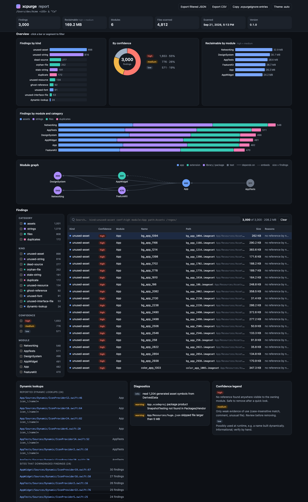

# xcpurge

Find unused assets, localized strings and files in Xcode projects and Swift packages, with a module-aware
reference model and a confidence level on every finding. Scanning is read-only; cleanup goes through a
restorable trash.

```
$ xcpurge scan Tests/Fixtures/ModularWorkspace --min-confidence high
...
Total: 12 findings (12 high, 0 medium, 0 low), 2.5 KB reclaimable
```

## What it finds

| Category | Kinds |
|---|---|
| assets | `unused-asset` (image/color/data/symbol sets, app icons, loose images), `unused-font`, `dynamic-lookup` (info) |
| strings | `unused-string`, `stale-string` (`.xcstrings`, `.strings`, `.stringsdict`, Settings.bundle), `dynamic-lookup` (info) |
| files | `orphan-file` (on disk, in no target: synced-folder exclusions, group files in no build phase, stray sources), `ghost-reference` (in the project, missing on disk), `dead-source`, `unused-interface-file`, `unused-resource` |
| duplicates | `duplicate` (byte-identical images across catalogs and loose files) |

Confidence:

- **high**: no reference anywhere the owning module is visible from. Safe to remove after a glance.
- **medium**: likely unused, but there is a reason to look (a bare string literal elsewhere, the main bundle
  read instead of the package bundle, an app icon set no setting names, a font declared in `UIAppFonts`).
- **low**: may be used at runtime (`Image("icon_\(i)")` matches `icon_1`), only used from previews,
  extension-only files, public API of a library with no in-repo consumer.

## Install

```sh
brew install iasaeed/tap/xcpurge
```

Or build from source:

```sh
git clone https://github.com/iasaeed/xcpurge.git && cd xcpurge
make install          # swift build -c release, then copies to /usr/local/bin (or ~/.local/bin)
# or just: swift build -c release   (binary at .build/release/xcpurge)
```

Requires macOS 14+ and Swift 6 (Xcode 26 or newer). A Mint package is planned.

## Quick start

```sh
xcpurge scan                          # everything, text report (the default subcommand)
xcpurge scan --min-confidence medium  # hide low-confidence findings
xcpurge assets path/to/App            # assets + duplicates only
xcpurge modules --verbose             # how files were attributed to modules
xcpurge init                          # starter xcpurge.json and .xcpurgeignore
xcpurge doctor                        # Xcode/Swift versions and project formats found
```

Text output is grouped by category, kind and module, with sizes and a total (colors only on a TTY, never
when `NO_COLOR` is set):

```
Assets (6, 7.6 KB)
  unused-asset
    App
      [medium] App/App/Assets.xcassets/LegacyIcon.appiconset  LegacyIcon  (6.6 KB)
          app icon set not named by ASSETCATALOG_COMPILER_APPICON_NAME, ALTERNATE_APPICON_NAMES, INCLUDE_ALL_APPICON_ASSETS or Info.plist icons
      [high]   App/App/Assets.xcassets/unused_app_image.imageset  unused_app_image  (236 B)
    DesignSystem
      [high]   Packages/DesignSystem/Sources/DesignSystem/Resources/DesignSystem.xcassets/ds_isolated.imageset  ds_isolated  (231 B)

Strings (6)
  unused-string
    DesignSystem
      [medium] Packages/DesignSystem/Sources/DesignSystem/Resources/Localizable.xcstrings:4  ds_no_bundle
          Packages/DesignSystem/Sources/DesignSystem/DSStrings.swift:6 has no bundle: argument, so it reads Bundle.main (likely wrong bundle)
```

## The multi-module model

Every file is attributed to the modules that build it: Xcode targets (classic groups, synchronized folders
with their exception sets, `.xcproj` folders), local Swift package targets, workspaces expanding to their
projects. A file no target builds is **unattributed** and counts as visible everywhere (conservative: it can
only hide findings, never create them).

A reference counts for a resource in module M only when the referencing file belongs to M or to a module that
can see M: anything that depends on M (directly or transitively) or embeds it. With `--ignore-test-references`,
test targets stop counting.

The `ModularWorkspace` fixture shows both directions:

```
$ xcpurge modules Tests/Fixtures/ModularWorkspace
Modules (5)
  App  [app]  App/App.xcodeproj  files: 23
    depends on: AppWidget, Core, DesignSystem
    embeds: AppWidget
    visible to: AppTests
  Core  [packageLibrary]  Packages/Core  files: 2
    visible to: App, AppTests, DesignSystem
  DesignSystem  [packageLibrary]  Packages/DesignSystem  files: 4
    depends on: Core
    visible to: App, AppTests
```

- `logo` lives in DesignSystem and is used only from App as `Image(.logo)`. App depends on DesignSystem, so it
  is **used**.
- `ds_isolated` lives in DesignSystem and is named only from Core. Core does not depend on DesignSystem, so
  that reference cannot load it: **unused, high**.
- `shared_key` exists in DesignSystem's string catalog, but App reads it without `bundle: .module`, i.e. from
  the main bundle: **medium, "reads the main bundle, not DesignSystem's bundle"**.

### Several projects in one workspace

Projects of a workspace link to each other without a package: the app's Frameworks and Embed phases list the
other project's product with `sourceTree = BUILT_PRODUCTS_DIR` (Xcode's implicit dependencies), and a target
dependency may go through a `PBXContainerItemProxy` whose `containerPortal` is the other `.xcodeproj`. xcpurge
resolves both across every project it scans: product files by file, product or target name, proxies by
container and `remoteInfo`. The `CrossProject` fixture is an app whose image lives in another project's
framework:

```
$ xcpurge modules Tests/Fixtures/CrossProject
Modules (2)
  App  [app]  App/App.xcodeproj  files: 1
    depends on: Kit
    embeds: Kit
  Kit  [framework]  Kit/Kit.xcodeproj  files: 2
    visible to: App
```

`kit_hero` is used only from App (`UIImage(named: "kit_hero", in: Bundle(for: KitMarker.self), ...)`), so it is
used; `kit_unused` is **unused, high**. Scan the workspace's folder (or pass `--workspace`) so both projects are
parsed; a scan of one project alone cannot see the other's uses.

## Project formats

| Format | Support |
|---|---|
| `project.pbxproj`, classic groups and build phases (tested with objectVersion 54, 56, 77) | Full: membership, variant groups, embed/link phases, build settings, xcconfig `#include` |
| Synchronized folders (Xcode 16+, objectVersion 77) | Full: exception sets, inclusions for other targets, build-phase exceptions |
| Mixed groups + folders in one project (classic `PBXGroup` files, synchronized folders, blue folder references, `PBXVariantGroup`) | Supported (see the `MixedApp` fixture, which also builds with `xcodebuild`) |
| `project.xcproj` (Xcode 27.2 JSON5 format) | Best effort: used when newer than `project.pbxproj`; unknown keys warn; unknown `required-capabilities` turn membership off (files become unattributed) |
| Swift packages | `swift package dump-package` (30 s timeout), regex fallback with `--no-swift` or `XCPURGE_NO_SWIFT=1` |
| `.xcworkspace` at the root | Expanded to its projects and packages |
| Tuist, XcodeGen | Run on the generated projects |

`Pods/` is skipped unless `--include-pods`. `DerivedData`, `node_modules`, `.build`, hidden folders and folders
containing `XCBuildData` / `workspace-state.json` are never walked. A `build/` folder is skipped when it is build
output: at the scan root, beside a project, `Package.swift` or build script (`build.gradle`, `package.json`,
`pubspec.yaml`, `Makefile`, ...), or holding a `Debug`/`Release`/`Debug-*`/`Release-*`/`intermediates`/`outputs`/
`*.build` folder. A `build/` folder that holds a `Package.swift` or `.xcodeproj`, or any other source folder that
happens to be called `build`, is scanned.

Every file is scanned whatever its size. Generic text (JSON, HTML, CSS, JS, xcconfig) over 5 MB is streamed in
1 MB chunks and scanned line by line; a literal on a single line longer than a chunk can be cut at a chunk
boundary and missed. A reference source that cannot be read at all caps every finding at medium (it could hold
the only use), unless it is under `--exclude`.

## Output formats and CI

`--format text|json|xcode|github|html`. `--output FILE` writes the report to a file instead of stdout.
`--fail-on` exits 1 when a finding matches: `any`, a category
(`assets`, `unused-assets`, `strings`, `files`, `duplicates`) or a kind (`dead-source`). Exit codes: 0 ok,
1 `--fail-on` hit, 2 usage or config error, 3 internal error.

```
$ xcpurge scan --format xcode
.../App/Dead/DeadHelper.swift:1: warning: [xcpurge] dead-source: 'DeadHelper.swift' in App: declares DeadHelper; not referenced from another visible file (high)
$ xcpurge scan Tests/Fixtures/ModularWorkspace --format github
::warning file=Tests/Fixtures/ModularWorkspace/App/App/Assets.xcassets/icon_1.imageset/Contents.json,line=1,title=xcpurge unused-asset::'icon_1' in App: ... (low)
```

GitHub `file=` paths are relative to `$GITHUB_WORKSPACE` (else the working directory), so scanning a subfolder
annotates the right file. Folder findings (image sets) point at their `Contents.json`.

GitHub Actions:

```yaml
- name: xcpurge
  run: xcpurge scan --format github --min-confidence medium --fail-on unused-assets
```

Xcode run-script build phase (shows findings as build warnings):

```sh
if command -v xcpurge >/dev/null; then
  xcpurge scan "$SRCROOT" --format xcode --min-confidence medium
fi
```

JSON (`schemaVersion: 1`) contains `tool`, `root`, `modules`, `summary`, `findings` (sorted by category, kind,
path, name, line) and `diagnostics`. Two runs on the same tree produce identical output.

### HTML report

`--format html` writes one self-contained page (inline CSS and JS, no network requests) with filters by
category, confidence and module, search, sorting and a detail drawer with every reason. It always goes to a
file: `--output FILE`, else `<path>/.xcpurge/report-<yyyyMMdd-HHmmss>.html` (add `.xcpurge/` to `.gitignore`).
`--open` opens it when written, in the default browser or the app given by `--browser` ("Google Chrome",
"Safari", ...).

```sh
xcpurge scan --format html --open
xcpurge assets ~/src/MyApp --format html --output /tmp/assets.html --open --browser "Google Chrome"
```




The template lives in `Sources/XcpurgeKit/Resources/report.html` and is compiled into the binary as
`ReportTemplate.swift`, so a copied-out `xcpurge` needs no resource bundle. After editing the HTML run
`make template`; a test fails when the two drift.

## Ignoring things

`.xcpurgeignore` at the scan root, gitignore style; the last matching rule wins, `!` re-includes:

```
Vendor/**                 # path globs, relative to the root
/Scripts/                 # leading / anchors at the root, trailing / matches directories
asset:server_driven_*     # asset names (wildcards)
string:push.*             # localization keys
module:LegacyKit          # every finding in a module
kind:dead-source          # a whole kind (kebab-case or camelCase)
```

In source, a `// xcpurge:ignore` comment on a line (or alone on the line above a declaration) suppresses
findings on that line, for every detector; a dead-source file containing a marker is skipped.

`xcpurge.json` (or `--config FILE`) sets defaults; command-line flags override it. JSON5 comments and trailing
commas are allowed, unknown keys are ignored.

| Key | Type | Default | Flag |
|---|---|---|---|
| `project` | string | - | `--project` |
| `workspace` | string | - | `--workspace` |
| `package` | string | - | `--package` |
| `targets` | [string] | `[]` (all) | `--targets` |
| `format` | `text` \| `json` \| `xcode` \| `github` \| `html` | `text` | `--format` |
| `failOn` | [string] | `[]` | `--fail-on` |
| `minConfidence` | `low` \| `medium` \| `high` | `low` | `--min-confidence` |
| `exclude` | [glob] | `[]` | `--exclude` (adds) |
| `derivedData` | path | newest matching folder | `--derived-data` |
| `includePods` | bool | `false` | `--include-pods` |
| `ignoreTestReferences` | bool | `false` | `--ignore-test-references` |
| `retainPublic` | bool | `false` | `--retain-public` |
| `noSwift` | bool | `false` | `--no-swift` |
| `verbose` | bool | `false` | `--verbose` |
| `localizationMacros` | [string] | `[]` | `--localization-macro` (adds) |

`exclude` globs hide **findings**: nothing inside them is reported (and they cannot make another file a
duplicate), and no project or package inside them is discovered. Excluded files are still read as references,
so excluding generated code (SwiftGen, R.swift) or vendored code never makes what they use look unused.
`xcpurge init` writes `"exclude": ["Vendor/**"]`; generated accessor files are recognized without excluding them.

## Safe cleanup

```sh
xcpurge assets --delete            # move unused assets to .xcpurge-trash, edit classic pbxproj references
xcpurge strings --prune            # remove unused keys from .xcstrings/.strings/.stringsdict
xcpurge files --delete             # move orphans, unused resources and xibs/storyboards to the trash
xcpurge restore --list             # sessions
xcpurge restore [--session ID]     # undo (newest by default), byte-identical
```

Actions ask for confirmation (`--yes` skips it) and touch only **high** findings unless `--min-confidence` is
given explicitly. Everything moved or rewritten goes into `.xcpurge-trash/<session>/` with a manifest (never a
`.bak` next to the file, which would ship inside a synced folder or `.lproj`). Add `.xcpurge-trash/` to
`.gitignore`. Dead-source and ghost findings are reported, never deleted.

Project edits are dry-run first: a file is moved only when every project referencing it can drop the
reference (classic `project.pbxproj`, LF or CRLF, `.xcdatamodeld` version groups included). Files referenced
by a `project.xcproj`, or by a pbxproj line the editor cannot change safely, stay in place and are listed as
skipped. After the action the report lists only what is left.

## Known limitations

| Limitation | Effect | Workaround |
|---|---|---|
| Static text matching, no type checking | A name spelled in an unrelated literal keeps a resource alive | `--min-confidence` and review medium findings |
| Unattributed files are visible everywhere | Docs or design mockups that mention a name keep it alive (a mockup HTML with `font-family: "Delius"` keeps the Delius font) | Scan a subfolder or keep mockups outside the scan root (`--exclude` hides findings, not references) |
| Bundle-less lookups in packages (`Image("logo")` in a design-system package) | Read `Bundle.main` at runtime, so they count for the app's own resources at medium only | Pass `bundle:` or review the medium finding |
| Format keys (`"%lld of %lld"`) | Matched to interpolations (`"\(a) of \(b)"`) by their literal segments; unmatched ones are medium, never high | |
| Names built at runtime | Matching resources are only ever low, never removed by default | `asset:`/`string:` ignore entries |
| Dead-source works per file | A file whose declarations are used only by itself and other dead files is found; dead declarations inside a live file are not | Use Periphery for declaration-level analysis |
| Unattributed files in a project scan are not dead-source candidates | Stray scripts are not reported as dead code | They are reported as orphans when inside a source root |
| Generated accessors | Recognized for SwiftGen, R.swift and Xcode's `GeneratedAssetSymbols.swift` (by header or file name) | `--derived-data` for Xcode's symbol index |
| `.xcproj` | Best effort until the format is final; unknown capabilities make membership untrusted | `xcpurge doctor` shows which format was used |
| `.copy` package resources, blue folder references, `urls(forResourcesWithExtension:)` | Contents reported low only | |
| Classic groups without paths (Expo/React Native templates) | Files there are not in a "source root", so only stray `.swift/.m/.c` files are reported as orphans (low) | |
| Sources in a project folder outside every group (`Stray/Stray.swift`) | Reported as low orphans; top-level files and tooling folders (`Scripts`, `fastlane`, `Vendor`, ...) are skipped | `.xcpurgeignore` |

## Roadmap

- **Precise mode**: optional IndexStoreDB / SwiftSyntax pass over a built project, and Xcode's `.stringsdata`
  for exact string usage.
- SARIF output, a Mint package, delete support for `.xcproj` projects.

## Comparison

| | xcpurge | FengNiao | Periphery | xcprune |
|---|---|---|---|---|
| Unused images | Catalogs, loose, generated symbols, module-aware | File-name search in source | No | Unverified |
| Colors, data sets, fonts | Yes | No | No | Unverified |
| Localized strings | `.xcstrings`, `.strings`, `.stringsdict` | No | No | Unverified |
| Unused code | Whole files (heuristic) | No | Declarations (compiler index, needs a build) | Unverified |
| Orphan / missing project files | Yes | No | No | Unverified |
| Needs a build | No | No | Yes | Unverified |
| Deletes | Restorable trash | Deletes files | No | Unverified |

The name is one letter from **xcprune**. We could not find a public tool by that name when writing this, but
check before publishing or announcing.

## Contributing

`make build`, `make test`, `make template` (after editing the HTML report template). Fixtures live in `Tests/Fixtures/<Name>`, expected findings in
`Tests/Goldens/<Name>/expected-<category>.json` (kept outside the fixtures so scans never read them). Rewrite
goldens with `XCPURGE_UPDATE_EXPECTED=1 swift test` and review the diff. `make corpus` runs read-only scans
over real projects listed in `CORPUS`.

## License

MIT, see `LICENSE`.
